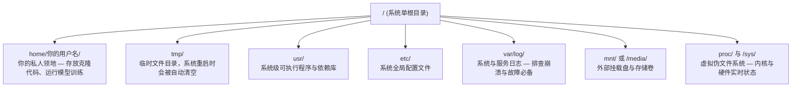

# Linux for AI

> 绝大多数 AI 系统与大模型都运行在 Linux 之上。你必须掌握足够的系统知识，才能在无图形界面的远程环境中游刃有余。

**Type:** Learn  
**Languages:** --  
**Prerequisites:** Phase 0, Lesson 01  
**Time:** ~30 minutes  

## 学习目标

- 熟练掌握 Linux 文件系统布局，在纯命令行中执行核心文件操作
- 使用 `chmod` 和 `chown` 管理文件权限，根治各类“Permission denied”故障
- 使用 `apt` 安装系统级软件包，从零配置一台用于 AI 研发的全新 GPU 云服务器
- 透彻识别 macOS 与 Linux 之间的底层行为差异，避免远程工作时踩坑

## 痛点与背景

你平时在 macOS 或 Windows 上进行开发。但一旦你通过 SSH 登录云端 GPU 实例、租用 Lambda 机器或启动 EC2 实例，你面对的就是纯粹的 Ubuntu 环境。终端是你唯一的交互界面。这里没有访达（Finder），没有资源管理器（Explorer），没有任何图形界面（GUI）。如果你无法在命令行中自如地穿梭文件系统、安装依赖包和管理进程，你就会在按小时扣费的高昂空闲 GPU 算力账单面前，一边抓狂一边在搜索引擎里反复搜索“Linux 怎么解压文件”。

这是一份生存手册。它直击你在远程 Linux 机器上开展 AI 工作所需的核心技能，绝无任何多余废话。

## 文件系统拓扑结构

Linux 将所有文件与目录统一组织在唯一的单根目录 `/` 下。这里不存在 `C:\` 盘符，也不存在 `/Volumes`。你真正会用到的关键目录如下：



你的用户主目录是 `~` 或 `/home/你的用户名`。你 99% 的操作都发生在这里。

## 核心命令集

以下 15 个命令覆盖了你在远程 GPU 服务器上 95% 的日常操作需求：

### 移动与路径导航

```bash
pwd                         # 我在哪里？（打印当前绝对路径）
ls                          # 当前目录下有什么？
ls -la                      # 当前目录下有什么，包含隐藏文件与详细权限信息？
cd /path/to/dir             # 切换到目标路径
cd ~                        # 回到用户主目录
cd ..                       # 返回上一级父目录
```

### 文件与目录操作

```bash
mkdir my-project            # 创建单个目录
mkdir -p a/b/c              # 一键递归创建多层嵌套目录

cp file.txt backup.txt      # 复制文件
cp -r src/ src-backup/      # 递归复制整个目录

mv old.txt new.txt          # 重命名文件
mv file.txt /tmp/           # 移动文件

rm file.txt                 # 删除文件（没有回收站，删完直接消失）
rm -rf my-dir/              # 强制递归删除整个目录及内部所有内容
```

`rm -rf` 是不可逆的永久销毁操作。没有任何撤销键。敲回车前必须反复核对路径。

### 查看文件内容

```bash
cat file.txt                # 打印整个文件内容到屏幕
head -20 file.txt           # 只查看前 20 行
tail -20 file.txt           # 只查看后 20 行
tail -f log.txt             # 实时追踪日志文件更新（Ctrl+C 中断退出）
less file.txt               # 分页滚屏交互式查看长文件（按 q 退出）
```

### 搜索与查找

```bash
grep "error" training.log           # 查找包含 "error" 的所有行
grep -r "learning_rate" .           # 在当前目录下所有文件中递归搜索变量
grep -i "cuda" config.yaml          # 忽略大小写进行搜索

find . -name "*.py"                 # 查找当前目录下所有 Python 源码文件
find . -name "*.ckpt" -size +1G     # 查找体积大于 1GB 的模型检查点权重文件
```

## 文件权限

Linux 中的每个文件都具备明确的所有者与权限标志位。当脚本拒绝执行或无法写入目录时，你就会遇到权限问题。

```bash
ls -l train.py
# -rwxr-xr-- 1 user group 2048 Mar 19 10:00 train.py
#  ^^^             所有者权限 (Owner)：读、写、执行
#     ^^^          所属组权限 (Group)：读、执行
#        ^^        其他所有人 (Others)：只读
```

常用权限修复命令：

```bash
chmod +x train.sh           # 为脚本赋予可执行权限
chmod 755 deploy.sh         # 所有者拥有全部权限，其他人拥有读与执行权限
chmod 644 config.yaml       # 所有者拥有读写权限，其他人拥有只读权限

chown user:group file.txt   # 修改文件的所有者与所属组（需要 sudo 权限）
```

当终端报“Permission denied”时，绝大多数情况都是权限标志位的问题。使用 `chmod +x` 或 `sudo` 可以解决绝大部分情况。

## 软件包管理 (apt)

Ubuntu 采用 `apt` 管理底层软件。这是你在系统层面安装工具的标准方式。

```bash
sudo apt update             # 刷新软件包索引列表（安装新软件前必须先执行）
sudo apt install -y htop    # 安装软件包（-y 参数跳过人工交互确认）
sudo apt install -y build-essential  # C/C++ 编译器、make 等，大量 Python 底层扩展编译必需
sudo apt install -y tmux    # 终端多路复用器（断开 SSH 后让训练在后台永续保活）

apt list --installed        # 列出本机所有已安装的软件包
sudo apt remove htop        # 卸载指定软件包
```

在一台刚初始化的纯净 GPU 机器上，通常必装的软件全家桶如下：

```bash
sudo apt update && sudo apt install -y \
    build-essential \
    git \
    curl \
    wget \
    tmux \
    htop \
    unzip \
    python3-venv
```

## 用户与 sudo 机制

日常工作中你通常以普通用户身份登录。某些系统级操作需要 root（超级管理员）权限。

```bash
whoami                      # 查询我当前是谁？
sudo command                # 以 root 权限单次提升运行指定命令
sudo su                     # 切换并停留为 root 用户（敲 exit 退出返回，生产中请极其谨慎使用）
```

在云端 GPU 实例上，你通常是唯一的使用者且拥有 sudo 权限。但切记不要以 root 用户运行所有程序。只在真正需要系统权限时使用 sudo。

## 进程管理与 systemd

当模型训练卡死、或者需要排查当前有哪些进程在运行时：

```bash
htop                        # 交互式进程监控器（按 q 退出）
ps aux | grep python        # 精准查找正在运行的 Python 进程
kill 12345                  # 优雅停止 PID 为 12345 的进程（发送 SIGTERM）
kill -9 12345               # 强制杀死进程（优雅退出无效时的终极手段）
nvidia-smi                  # 查看 GPU 计算进程与显存占用详情
```

`systemd` 负责管理系统的后台服务（Daemon）。当你部署常驻模型推理服务时会用到它：

```bash
sudo systemctl start nginx          # 启动服务
sudo systemctl stop nginx           # 停止服务
sudo systemctl restart nginx        # 重启服务
sudo systemctl status nginx         # 查看服务运行状态
sudo systemctl enable nginx         # 设置开机自启
```

## 磁盘空间管理

GPU 机器的磁盘空间往往寸土寸金。大模型权重与数据集会以极快速度将硬盘填满。

```bash
df -h                       # 查询所有已挂载磁盘分区的容量与剩余空间
df -h /home                 # 专门查看 /home 分区的磁盘使用情况

du -sh *                    # 统计当前目录下各个项目的总大小
du -sh ~/.cache             # 查看缓存占用（pip、huggingface 模型权重都存放在这里）
du -sh /data/checkpoints/   # 查看模型检查点文件夹占用了多少空间

# 深度大户排查利器：查找最吃磁盘的前 20 个大目录
du -h --max-depth=1 / 2>/dev/null | sort -hr | head -20
```

常见磁盘空间清理手段：

```bash
# 清空 pip 轮子缓存
pip cache purge

# 清空 apt 安装包缓存
sudo apt clean

# 删除不再需要的旧检查点目录
rm -rf checkpoints/epoch_01/ checkpoints/epoch_02/
```

## 网络与文件传输

你需要在命令行中直接下载模型、传输权重以及调用 API。

```bash
# 下载文件
wget https://example.com/model.bin                   # 使用 wget 直接下载
curl -O https://example.com/data.tar.gz              # 使用 curl 下载同款文件
curl -s https://api.example.com/health | python3 -m json.tool  # 调用 API 接口并格式化打印 JSON

# 跨机器文件传输
scp model.bin user@remote:/data/                     # 复制文件到远程机器
scp user@remote:/data/results.csv .                  # 从远程机器复制文件到本地
scp -r user@remote:/data/checkpoints/ ./local-dir/   # 递归复制整个目录

# 目录同步（大文件传输体验远好于 scp，且支持断点续传）
rsync -avz --progress ./data/ user@remote:/data/
rsync -avz --progress user@remote:/results/ ./results/
```

对任何大型数据集或权重传输，务必优先选择 `rsync` 而非 `scp`。`rsync` 仅传输变动的差异字节，并且能优雅处理网络中断。

## tmux：让训练会话永续保活

当你通过 SSH 连接远程服务器时，关闭笔记本电脑盖子会直接杀死你的训练进程。`tmux` 能杜绝这种灾难。

```bash
tmux new -s train           # 启动一个名为 "train" 的全新会话
# ... 在里面启动你的模型训练，然后：
# 按 Ctrl+B，松开后按 D     # 脱离会话（Detach，训练在后台平稳继续运行）

tmux ls                     # 查看所有存活的会话列表
tmux attach -t train        # 重新接入（Reattach）会话

# 在 tmux 窗口内部：
# 按 Ctrl+B，松开后按 %     # 垂直切分窗格（左右分屏）
# 按 Ctrl+B，松开后按 "     # 水平切分窗格（上下分屏）
# 按 Ctrl+B，松开后按方向键 # 在各个窗格之间切换光标
```

长时间的训练任务，务必永远运行在 `tmux` 会话之中。切记。

## 面向 Windows 用户的 WSL2

如果你使用 Windows，WSL2 允许你在免装双系统的前提下拥有真正的 Linux 内核环境。

```bash
# 在管理员权限 PowerShell 中运行：
wsl --install -d Ubuntu-24.04

# 重启电脑后，从开始菜单打开 Ubuntu：
sudo apt update && sudo apt upgrade -y
```

WSL2 运行着真实的 Linux 内核。本课程中的所有命令均能在其中原生运行。在 WSL2 内部，你的 Windows 文件挂载在 `/mnt/c/Users/你的用户名/`。

GPU 直通功能依赖于 Windows 侧安装的 NVIDIA 显卡驱动。只需要在 Windows 安装驱动（无需在 Linux 内部安装驱动），CUDA 即可在 WSL2 中直接生效。

## 踩坑点：macOS 到 Linux 的关键差异

如果你是从 macOS 转战 Linux，以下细节常常会让你踩坑：

| macOS | Linux | 核心差异与排坑要点 |
|-------|-------|-------------------|
| `brew install` | `sudo apt install` | 软件包名称有时不同。`brew install htop` 和 `sudo apt install htop` 相同，但 `brew install readline` 在 Linux 对应 `sudo apt install libreadline-dev`。 |
| `open file.txt` | `xdg-open file.txt` | 但在远程无头服务器上根本没有图形界面。请使用 `cat` 或 `less`。 |
| `pbcopy` / `pbpaste` | 不可用 | 跨 SSH 无法使用本地系统剪贴板。 |
| `~/.zshrc` | `~/.bashrc` | macOS 默认使用 zsh。绝大多数 Linux 服务器默认使用 bash。 |
| `/opt/homebrew/` | `/usr/bin/`, `/usr/local/bin/` | 可执行程序的存放系统路径完全不同。 |
| `sed -i '' 's/a/b/' file` | `sed -i 's/a/b/' file` | macOS 的 sed 必须在 `-i` 后带空字符串。Linux 严禁加空字符串。 |
| 大小写不敏感文件系统 | 大小写严格敏感文件系统 | 在 Linux 下，`Model.py` 和 `model.py` 是两个完全不同的独立文件。 |
| 换行符 `\n` | 换行符 `\n` | 两者一致。但 Windows 使用 `\r\n`，会导致 bash 脚本报错。执行 `dos2unix` 即可修复。 |

## 快速速查卡 (Quick Reference Card)

```text
路径导航:       pwd, ls, cd, find
文件操作:       cp, mv, rm, mkdir, cat, head, tail, less
检索查找:       grep, find
权限管理:       chmod, chown, sudo
软件安装:       apt update, apt install
进程监控:       htop, ps, kill, nvidia-smi
系统服务:       systemctl start/stop/restart/status
磁盘管理:       df -h, du -sh
网络操作:       curl, wget, scp, rsync
会话保活:       tmux new/attach/detach
```

```figure
s0-process-fork
```

## 课后实操练习 (Exercises)

1. 通过 SSH 登录任意 Linux 机器（或打开本地 WSL2）并进入你的用户主目录。创建一个项目文件夹，使用 `touch` 在内部创建 3 个空文件，然后用 `ls -la` 查看它们的详细属性。
2. 使用 apt 安装 `htop`，运行它，并找出当前占用物理内存最多的进程是哪一个。
3. 启动一个 tmux 会话，在内部运行 `sleep 300`，脱离会话，列出所有会话，并重新接入该会话。
4. 使用 `df -h` 检查可用磁盘空间，然后使用 `du -sh ~/.cache/*` 排查你的缓存目录中具体是哪项占用了最多空间。
5. 使用 `scp` 将一个文件从本地机器传输到远程机器，然后使用 `rsync` 完成同样的传输，亲身体验并对比两者的速度与输出反馈。
