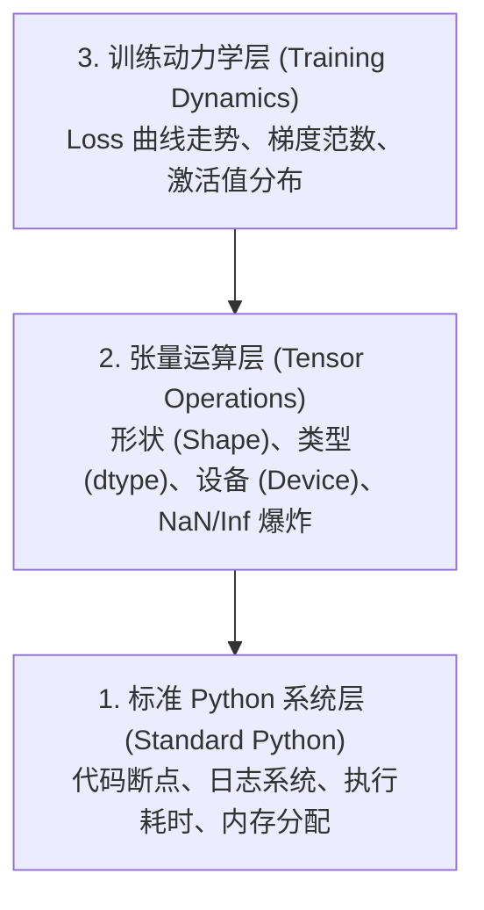

# 调试与性能分析 (Debugging and Profiling)

> 最致命的 AI 漏洞从不崩溃。它们悄无声息地在垃圾数据上训练，并向你汇报一条极其漂亮的 Loss 曲线。

**Type:** Build  
**Language:** Python  
**Prerequisites:** Lesson 1 (Dev Environment), 基础 PyTorch 经验  
**Time:** ~60 minutes  

## 学习目标

- 使用条件断点 `breakpoint()` 和 `debug_print` 在训练中途检查张量形状（Shape）、数据类型（dtype）与 NaN 异常值
- 使用 `cProfile`、`line_profiler` 和 `tracemalloc` 对训练循环进行性能分析，定位性能瓶颈
- 诊断排查常见的 AI 专属 Bug：张量形状不匹配、Loss 变 NaN、数据泄露（Data Leakage）以及跨设备张量冲突
- 配置并使用 TensorBoard 可视化 Loss 曲线、权重直方图以及梯度分布

## 痛点与背景

AI 代码崩溃的方式与传统软件截然不同。普通的 Web 应用报错时会抛出堆栈跟踪（Stack Trace）直接崩溃退出。而一个配置错误的深度学习训练循环，却能够默默奔跑 8 个小时，烧掉数百美元的 GPU 算力，最后产出一个永远只会输出输入均值的报废模型。代码从始至终没有报错。Bug 可能是某个张量遗漏在 CPU 上、漏写了一个 `.detach()`、或者是测试集标签悄悄泄露进了特征中。

你需要一整套针对性的调试武器库，在这些“静默故障”浪费你宝贵的时间与算力之前，精准捕获它们。

## 核心架构与分层概念

AI 调试运行在三个层次之上：



大多数新手遇到训练不收敛，直接跳到第 3 层盯着 TensorBoard 发呆。然而现实中，**80% 的 AI Bug 都根植在第 1 层和第 2 层**。

```figure
s0-flame-hot
```

## 动手构建：调试工具箱

### 第 1 部分：Print 打印调试（简单却极度高效）

很多人轻视 `print` 调试。但在张量世界里，针对性的 `print` 往往远比单步调试器更高效，因为你需要同时一眼看清张量的形状、精度、设备与数值区间。

```python
def debug_print(name, tensor):
    print(f"{name}: shape={tensor.shape}, dtype={tensor.dtype}, "
          f"device={tensor.device}, "
          f"min={tensor.min().item():.4f}, max={tensor.max().item():.4f}, "
          f"mean={tensor.mean().item():.4f}, "
          f"has_nan={tensor.isnan().any().item()}")
```

在任何令人生疑的张量操作后插入这行函数。排查出问题后随手删掉即可。

### 第 2 部分：Python 原生调试器（pdb 与 breakpoint）

Python 内置的调试器在 AI 领域被严重低估。在训练循环中放入条件 `breakpoint()`，可以在张量异常时直接进入交互式探针环境：

```python
def training_step(model, batch, criterion, optimizer):
    inputs, labels = batch
    outputs = model(inputs)
    loss = criterion(outputs, labels)

    # 仅在 Loss 异常飙升或出现 NaN 时触发断点停下
    if loss.item() > 100 or torch.isnan(loss):
        breakpoint()

    loss.backward()
    optimizer.step()
```

当程序在断点处停下并把控制台交给你时，极实用的交互命令包括：
- `p outputs.shape`：查看模型输出维度
- `p loss.item()`：查看当前 Loss 标量值
- `p torch.isnan(outputs).sum()`：统计输出中产生了多少个 NaN
- `p model.fc1.weight.grad`：直接查看某一层权重的梯度张量
- `c`：继续全速运行（Continue）；`q`：退出调试

这就是**条件调试（Conditional Debugging）**。对于几万步的长时间训练，只有在真正出错的瞬间停下，才是最优雅的排查姿势。

### 第 3 部分：工业级日志系统（Python Logging）

当调试超出一两行的临时排查时，用标准 `logging` 替代 `print`：

```python
import logging

logging.basicConfig(
    level=logging.INFO,
    format="%(asctime)s [%(levelname)s] %(message)s",
    handlers=[
        logging.FileHandler("training.log"),
        logging.StreamHandler()
    ]
)
logger = logging.getLogger(__name__)

logger.info("Starting training: lr=%.4f, batch_size=%d", lr, batch_size)
logger.warning("Loss spike detected: %.4f at step %d", loss.item(), step)
logger.error("NaN loss at step %d, stopping", step)
```

日志自带精确时间戳、严重程度分级（INFO、WARNING、ERROR）以及自动落盘文件能力。当模型在半夜凌晨 3 点训练崩溃时，你需要的是详实的日志文件，而不是被终端刷掉的屏幕碎片。

### 第 4 部分：代码段耗时测定（Timer 上下文管理器）

定位性能瓶颈的第一步，是精确获知时间究竟消耗在哪里：

```python
import time

class Timer:
    def __init__(self, name=""):
        self.name = name

    def __enter__(self):
        self.start = time.perf_counter()
        return self

    def __exit__(self, *args):
        elapsed = time.perf_counter() - self.start
        print(f"[{self.name}] {elapsed:.4f}s")

with Timer("data loading"):
    batch = next(dataloader_iter)

with Timer("forward pass"):
    outputs = model(batch)

with Timer("backward pass"):
    loss.backward()
```

**工业界常见排查结论**：很多新手花大价钱升级 GPU，测出来才发现 60% 以上的时间都消耗在 CPU 的数据加载（Data Loading）上。根本不需要换显卡，把 DataLoader 的 `num_workers > 0` 开启多进程数据加载，GPU 利用率瞬间就能拉满。

### 第 5 部分：cProfile 与 line_profiler

当你需要全面、自动化的性能画像时：

```bash
python -m cProfile -s cumtime train.py
```
这会列出所有函数调用的累积耗时排行。若需单行级别的逐行耗时分析：

```bash
pip install line_profiler
```

```python
@profile
def train_step(model, data, target):
    output = model(data)
    loss = F.cross_entropy(output, target)
    loss.backward()
    return loss

# 运行命令：kernprof -l -v train.py
```

### 第 6 部分：内存与显存画像 (Memory Profiling)

#### 1. CPU 物理内存监控：tracemalloc
```python
import tracemalloc

tracemalloc.start()

model = build_model()
data = load_dataset()

snapshot = tracemalloc.take_snapshot()
top_stats = snapshot.statistics("lineno")
for stat in top_stats[:10]:
    print(stat)
```

#### 2. CPU 逐行内存监控：memory_profiler
```bash
pip install memory_profiler
```

```python
from memory_profiler import profile

@profile
def load_data():
    raw = read_csv("data.csv")        # 观察此处内存跳增
    processed = preprocess(raw)       # 观察此处内存跳增
    return processed
```
运行 `python -m memory_profiler your_script.py`，查看代码每执行一行的物理内存增减。

#### 3. GPU 显存监控：PyTorch 原生接口
```python
import torch

if torch.cuda.is_available():
    print(torch.cuda.memory_summary())
    print(f"Allocated: {torch.cuda.memory_allocated() / 1e9:.2f} GB")
    print(f"Cached: {torch.cuda.memory_reserved() / 1e9:.2f} GB")
```

**遭遇 CUDA 显存打爆（OOM: Out of Memory）的标准五步自救法**：
1. **调小 Batch Size**（永远是排在第一位的操作）
2. 调用 `torch.cuda.empty_cache()` 释放 PyTorch 内部缓存的未分配显存块
3. 对超大中间张量显式使用 `del tensor`，紧随其后执行 `torch.cuda.empty_cache()`
4. 开启自动混合精度（AMP: `torch.cuda.amp.autocast()`），显存开销瞬间减半
5. 对极深的超大模型开启**梯度检查点（Gradient Checkpointing）**，用计算换显存

### 第 7 部分：四大经典 AI 专属 Bug 与捕获方案

#### 1. 形状不匹配 (Shape Mismatch)
最频发的 Bug。模型预期是 `[batch, channels, height, width]`，传入的却是 `[batch, features]`。
利用 PyTorch Forward Hook 一次性打印全模型每一层的形状变换：

```python
def check_shapes(model, sample_input):
    print(f"Input: {sample_input.shape}")
    hooks = []

    def make_hook(name):
        def hook(module, inp, out):
            in_shape = inp[0].shape if isinstance(inp, tuple) else inp.shape
            out_shape = out.shape if hasattr(out, "shape") else type(out)
            print(f"  {name}: {in_shape} -> {out_shape}")
        return hook

    for name, module in model.named_modules():
        hooks.append(module.register_forward_hook(make_hook(name)))

    with torch.no_grad():
        model(sample_input)

    for h in hooks:
        h.remove()
```

#### 2. Loss 变 NaN (NaN Loss)
Loss 突然变成 NaN 意味着数值发生爆炸。常见根因：
- 学习率设得过大（梯度爆炸）
- 自定义 Loss 中存在除以零（0/0）
- 对零或负数做对数运算（$\log(0)$）
- RNN / Transformer 缺乏梯度裁剪（Gradient Clipping）

```python
def detect_nan(model, loss, step):
    if torch.isnan(loss):
        print(f"NaN loss at step {step}")
        for name, param in model.named_parameters():
            if param.grad is not None:
                if torch.isnan(param.grad).any():
                    print(f"  NaN gradient in {name}")
                if torch.isinf(param.grad).any():
                    print(f"  Inf gradient in {name}")
        return True
    return False
```

#### 3. 数据泄露 (Data Leakage)
模型在测试集上准确率高达 99%。听起来像奇迹，实际上通常是严重 Bug：
- 训练集样本不小心混进了测试集
- 特征中误包含了目标标签自身
- 时间序列数据使用了未来的特征去预测过去

```python
def check_data_leakage(train_set, test_set, id_column="id"):
    train_ids = set(train_set[id_column].tolist())
    test_ids = set(test_set[id_column].tolist())
    overlap = train_ids & test_ids
    if overlap:
        print(f"DATA LEAKAGE: {len(overlap)} samples in both train and test")
        return True
    return False
```

#### 4. 跨设备张量冲突 (Wrong Device)
张量一部分在 CPU，一部分在 GPU，轻则直接抛出 `Expected all tensors to be on the same device` 崩溃；重则某些张量静默落在 CPU 上，导致全流程以龟速在软模拟中运行。

```python
def check_devices(model, *tensors):
    model_device = next(model.parameters()).device
    print(f"Model device: {model_device}")
    for i, t in enumerate(tensors):
        if t.device != model_device:
            print(f"  WARNING: tensor {i} on {t.device}, model on {model_device}")
```

### 第 8 部分：TensorBoard 可视化监控

TensorBoard 能让你直观洞察训练动态：

```bash
pip install tensorboard
```

```python
from torch.utils.tensorboard import SummaryWriter

writer = SummaryWriter("runs/experiment_1")

for step in range(num_steps):
    loss = train_step(model, batch)

    writer.add_scalar("loss/train", loss.item(), step)
    writer.add_scalar("lr", optimizer.param_groups[0]["lr"], step)

    if step % 100 == 0:
        for name, param in model.named_parameters():
            writer.add_histogram(f"weights/{name}", param, step)
            if param.grad is not None:
                writer.add_histogram(f"grads/{name}", param.grad, step)

writer.close()
```

启动查看命令：
```bash
tensorboard --logdir=runs
```

**看板诊断核心口诀**：
- **Loss 纹丝不动**：学习率太小，或者模型底层梯度断连
- **Loss 剧烈震荡跳动**：学习率过高
- **Loss 瞬间冲到 NaN**：数值不稳定（梯度爆炸或除以零）
- **Train Loss 一路下降，Val Loss 掉头狂升**：严重过拟合（Overfitting）
- **权重直方图全缩向 0**：梯度消失（Vanishing Gradients）
- **梯度直方图数值巨大发散**：梯度爆炸，必须加梯度裁剪 `clip_grad_norm_`

### 第 9 部分：VS Code 交互式调试配置

在 `.vscode/launch.json` 中配置：

```json
{
    "version": "0.2.0",
    "configurations": [
        {
            "name": "Debug Training",
            "type": "debugpy",
            "request": "launch",
            "program": "${file}",
            "console": "integratedTerminal",
            "justMyCode": false
        }
    ]
}
```

在行号左侧单击打红点断点。利用 Variables 面板查看张量，并在 Debug Console 中实时执行任意 Python 表达式。

---

## 生产实践工作流 (Use It)

捕捉 90% 以上 AI Bug 的标准流水线：
1. **训练启动前**：用 `check_shapes` 跑一次伪数据 Batch，核对输入输出维度与设计完全一致。
2. **前 10 个 Step**：使用 `debug_print` 盯紧 Loss、激活值与梯度，确认无 NaN 且处于正常数值范围。
3. **训练全流程**：实时记录 Loss、学习率与梯度范数，配合 TensorBoard 观察趋势。
4. **出现崩溃时**：在报错判定点直接注入 `breakpoint()` 进入条件断点交互。
5. **性能调优时**：测量 DataLoader 数据加载 vs 前向传播 vs 反向传播耗时，避免 GPU 空转。

---

## 代码运行验证 (Ship It)

运行课程提供的完整调试工具箱脚本：

```bash
python phases/00-setup-and-tooling/12-debugging-and-profiling/code/debug_tools.py
```

详见 `outputs/prompt-debug-ai-code.md` 提供的 AI 专属故障诊断提示词。

---

## 课后实操练习 (Exercises)

1. 运行 `debug_tools.py` 并通读各模块输出。修改其中的伪模型人为制造一个 NaN（例如在前向传播中除以零），观察 NaN 探测器是如何精准抓出故障的。
2. 使用 `cProfile` 分析一个训练循环，定位耗时最长的底层函数。
3. 使用 `tracemalloc` 找出数据加载流程中具体是哪一行代码分配了最大的物理内存。
4. 为简单的训练任务接入 TensorBoard，观察并判断模型是否存在过拟合。
5. 在训练循环中插入 `breakpoint()`。练习在调试器交互提示符下查看张量形状、所在设备以及参数梯度值。
