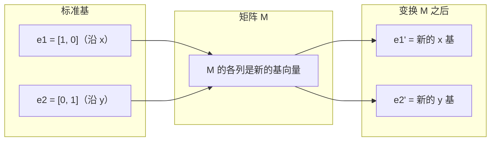
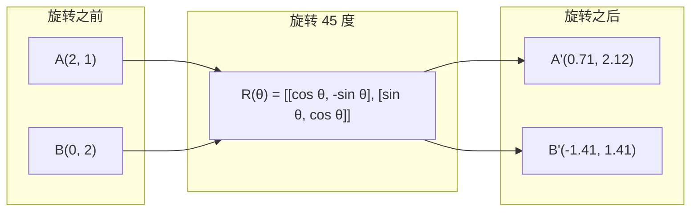
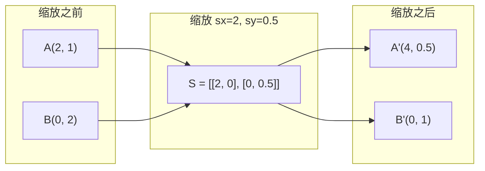
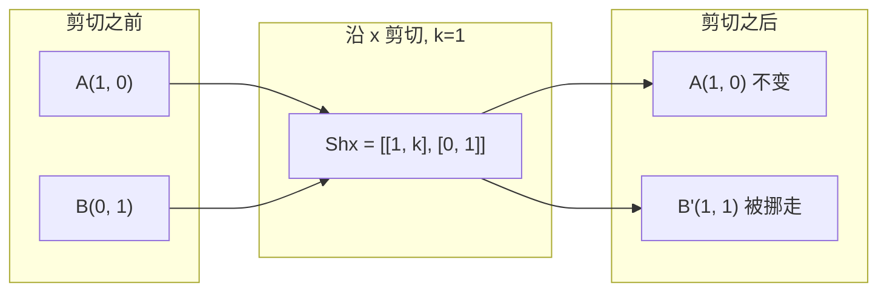
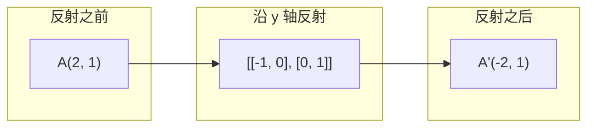
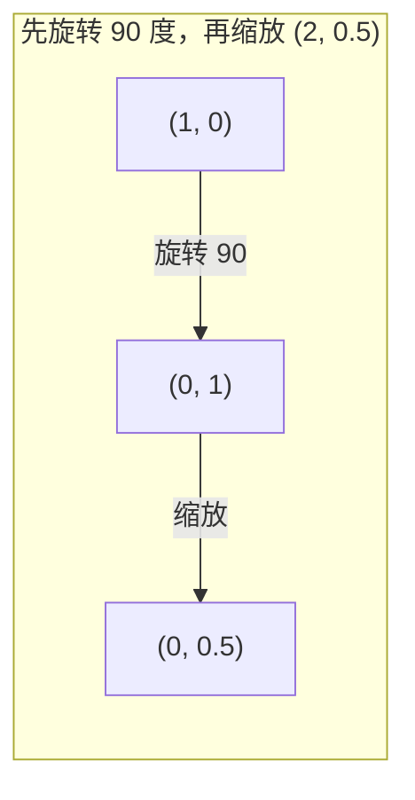
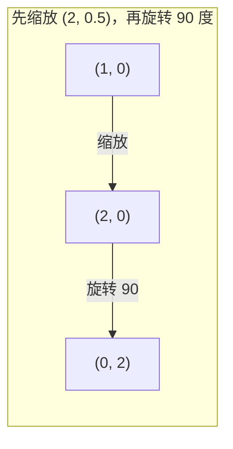

# 矩阵变换

> 矩阵是一台重新塑造空间的机器。弄清它把每个点送到哪里，你就理解了整次变换。

**Type:** Build
**Languages:** Python, Julia
**Prerequisites:** Phase 1, Lessons 01-02（线性代数直觉，向量与矩阵运算）
**Time:** ~75 minutes

## 学习目标

- 构造旋转、缩放、剪切和反射矩阵，并把它们作用到二维和三维的点上
- 用矩阵乘法把多次变换串起来，并验证顺序会改变结果
- 从特征方程出发，计算 2×2 矩阵的特征值和特征向量
- 说明特征值为什么决定 PCA 的方向、RNN 的稳定性，以及谱聚类的行为

## 问题

你读到 PCA，会看见「求协方差矩阵的特征向量」。你读到模型稳定性，会看见「检查所有特征值的绝对值是不是都小于 1」。你读到数据增强，会看见「施加一个随机旋转」。在你从几何上理解矩阵对空间做了什么之前，这些话都对不上。

矩阵不只是一格格的数字。它是空间机器。旋转矩阵把点转起来。缩放矩阵把点拉长或压短。剪切矩阵把点倾斜。神经网络对数据做的每一次变换，都是这些运算之一，或者是它们的组合。这一课把这些运算做成能亲手算的东西。

## 概念

### 变换写成矩阵

二维里的每一个线性变换都可以写成一个 2×2 矩阵。这个矩阵精确告诉你：基向量 `[1, 0]` 和 `[0, 1]` 会被送到哪里。其余所有点都由此决定。



### 旋转

把平面旋转角度 θ，距离和夹角都保持不变。每个点沿着一段圆弧移动。



三维里，你绕着一根轴旋转。每根轴有自己的旋转矩阵：

```text
Rz(theta) = | cos  -sin  0 |     绕 z 轴旋转
            | sin   cos  0 |     （x-y 平面在转，z 不动）
            |  0     0   1 |

Rx(theta) = | 1   0     0    |   绕 x 轴旋转
            | 0  cos  -sin   |   （y-z 平面在转，x 不动）
            | 0  sin   cos   |

Ry(theta) = |  cos  0  sin |     绕 y 轴旋转
            |   0   1   0  |     （x-z 平面在转，y 不动）
            | -sin  0  cos |
```

### 缩放

缩放沿每根轴独立地拉长或压短。



### 剪切

剪切让一根轴倾斜，另一根轴不动。矩形会变成平行四边形。



剪切矩阵：

- `Shx = [[1, k], [0, 1]]`：x 增加 `k * y`
- `Shy = [[1, 0], [k, 1]]`：y 增加 `k * x`

### 反射

反射把点沿一根轴或一条直线做镜像。



反射矩阵：

- 沿 y 轴反射：`[[-1, 0], [0, 1]]`
- 沿 x 轴反射：`[[1, 0], [0, -1]]`

### 复合：把变换串起来

先做变换 A，再做变换 B，等于把它们的矩阵相乘：`result = B @ A @ point`。顺序有影响。先旋转再缩放，和先缩放再旋转，结果不同。



合成矩阵：`S @ R = [[0, -2], [0.5, 0]]`



合成矩阵：`R @ S = [[0, -0.5], [2, 0]]`

两个结果不一样。矩阵乘法不能交换顺序。

### 特征值与特征向量

大多数向量被矩阵作用之后，方向会变。特征向量是特殊的：矩阵只缩放它们，不旋转它们。那个缩放倍数就是特征值。

```text
A @ v = lambda * v

v 是特征向量（留下来的那个方向）
lambda 是特征值（把它拉长了多少）

例子：A = | 2  1 |
          | 1  2 |

特征向量 [1, 1]，特征值 3：
  A @ [1,1] = [3, 3] = 3 * [1, 1]     （方向相同，放大 3 倍）

特征向量 [1, -1]，特征值 1：
  A @ [1,-1] = [1, -1] = 1 * [1, -1]  （方向相同，长度不变）
```

这个矩阵沿 `[1, 1]` 把空间拉长 3 倍，沿 `[1, -1]` 保持不变。其他方向都是这两个方向的混合。

### 特征分解

如果一个矩阵有 n 个线性无关的特征向量，它就可以分解成：

```text
A = V @ D @ V^(-1)

V = 各列是特征向量的矩阵
D = 对角线上放特征值的对角矩阵
V^(-1) = V 的逆矩阵

这句话的意思是：先转到特征向量坐标系，沿每根轴缩放，再转回去。
```

### 特征值为什么重要

**PCA。** 协方差矩阵的特征向量就是主成分。特征值告诉你每个成分带走了多少方差。按特征值从大到小排序，留下前 k 个，就是降维。

**稳定性。** 在循环网络和动力系统里，绝对值大于 1 的特征值会让输出爆炸。绝对值小于 1 会让输出消失。消失梯度和爆炸梯度，用这一句话就能说完。

**谱方法。** 图神经网络使用邻接矩阵的特征值。谱聚类使用拉普拉斯矩阵的特征值。特征向量把图的结构露出来。

### 行列式是体积的缩放倍数

变换矩阵的行列式告诉你，它把面积（二维）或体积（三维）放大了多少。

```text
det = 1:   面积不变（旋转）
det = 2:   面积变成 2 倍
det = 0:   空间被压到更低的维度（奇异）
det = -1:  面积不变，但朝向翻了（反射）

| det(旋转) | = 1            （永远）
| det(缩放 sx, sy) | = sx * sy
| det(剪切) | = 1            （面积不变）
| det(反射) | = -1           （朝向翻转）
```

```figure
matrix-transform
```

## 动手做

### 第 1 步：从零写出变换矩阵（Python）

```python
import math

def rotation_2d(theta):
    c, s = math.cos(theta), math.sin(theta)
    return [[c, -s], [s, c]]

def scaling_2d(sx, sy):
    return [[sx, 0], [0, sy]]

def shearing_2d(kx, ky):
    return [[1, kx], [ky, 1]]

def reflection_x():
    return [[1, 0], [0, -1]]

def reflection_y():
    return [[-1, 0], [0, 1]]

def mat_vec_mul(matrix, vector):
    return [
        sum(matrix[i][j] * vector[j] for j in range(len(vector)))
        for i in range(len(matrix))
    ]

def mat_mul(a, b):
    rows_a, cols_b = len(a), len(b[0])
    cols_a = len(a[0])
    return [
        [sum(a[i][k] * b[k][j] for k in range(cols_a)) for j in range(cols_b)]
        for i in range(rows_a)
    ]

point = [1.0, 0.0]
angle = math.pi / 4

rotated = mat_vec_mul(rotation_2d(angle), point)
print(f"Rotate (1,0) by 45 deg: ({rotated[0]:.4f}, {rotated[1]:.4f})")

scaled = mat_vec_mul(scaling_2d(2, 3), [1.0, 1.0])
print(f"Scale (1,1) by (2,3): ({scaled[0]:.1f}, {scaled[1]:.1f})")

sheared = mat_vec_mul(shearing_2d(1, 0), [1.0, 1.0])
print(f"Shear (1,1) kx=1: ({sheared[0]:.1f}, {sheared[1]:.1f})")

reflected = mat_vec_mul(reflection_y(), [2.0, 1.0])
print(f"Reflect (2,1) across y: ({reflected[0]:.1f}, {reflected[1]:.1f})")
```

### 第 2 步：变换的复合

```python
R = rotation_2d(math.pi / 2)
S = scaling_2d(2, 0.5)

rotate_then_scale = mat_mul(S, R)
scale_then_rotate = mat_mul(R, S)

point = [1.0, 0.0]
result1 = mat_vec_mul(rotate_then_scale, point)
result2 = mat_vec_mul(scale_then_rotate, point)

print(f"Rotate 90 then scale: ({result1[0]:.2f}, {result1[1]:.2f})")
print(f"Scale then rotate 90: ({result2[0]:.2f}, {result2[1]:.2f})")
print(f"Same? {result1 == result2}")
```

### 第 3 步：从零求特征值（2×2）

对于 2×2 矩阵 `[[a, b], [c, d]]`，特征值满足特征方程：`lambda^2 - (a+d)*lambda + (ad - bc) = 0`。

```python
def eigenvalues_2x2(matrix):
    a, b = matrix[0]
    c, d = matrix[1]
    trace = a + d
    det = a * d - b * c
    discriminant = trace ** 2 - 4 * det
    if discriminant < 0:
        real = trace / 2
        imag = (-discriminant) ** 0.5 / 2
        return (complex(real, imag), complex(real, -imag))
    sqrt_disc = discriminant ** 0.5
    return ((trace + sqrt_disc) / 2, (trace - sqrt_disc) / 2)

def eigenvector_2x2(matrix, eigenvalue):
    a, b = matrix[0]
    c, d = matrix[1]
    if abs(b) > 1e-10:
        v = [b, eigenvalue - a]
    elif abs(c) > 1e-10:
        v = [eigenvalue - d, c]
    else:
        if abs(a - eigenvalue) < 1e-10:
            v = [1, 0]
        else:
            v = [0, 1]
    mag = (v[0] ** 2 + v[1] ** 2) ** 0.5
    return [v[0] / mag, v[1] / mag]

A = [[2, 1], [1, 2]]
vals = eigenvalues_2x2(A)
print(f"Matrix: {A}")
print(f"Eigenvalues: {vals[0]:.4f}, {vals[1]:.4f}")

for val in vals:
    vec = eigenvector_2x2(A, val)
    result = mat_vec_mul(A, vec)
    scaled = [val * vec[0], val * vec[1]]
    print(f"  lambda={val:.1f}, v={[round(x,4) for x in vec]}")
    print(f"    A@v = {[round(x,4) for x in result]}")
    print(f"    l*v = {[round(x,4) for x in scaled]}")
```

### 第 4 步：行列式是体积的缩放倍数

```python
def det_2x2(matrix):
    return matrix[0][0] * matrix[1][1] - matrix[0][1] * matrix[1][0]

print(f"det(rotation 45) = {det_2x2(rotation_2d(math.pi/4)):.4f}")
print(f"det(scale 2,3)   = {det_2x2(scaling_2d(2, 3)):.1f}")
print(f"det(shear kx=1)  = {det_2x2(shearing_2d(1, 0)):.1f}")
print(f"det(reflect y)   = {det_2x2(reflection_y()):.1f}")

singular = [[1, 2], [2, 4]]
print(f"det(singular)     = {det_2x2(singular):.1f}")
print("Singular: columns are proportional, space collapses to a line.")
```

## 用起来

NumPy 用优化过的例程处理这些运算。

```python
import numpy as np

theta = np.pi / 4
R = np.array([[np.cos(theta), -np.sin(theta)],
              [np.sin(theta),  np.cos(theta)]])

point = np.array([1.0, 0.0])
print(f"Rotate (1,0) by 45 deg: {R @ point}")

S = np.diag([2.0, 3.0])
composed = S @ R
print(f"Scale(2,3) after Rotate(45): {composed @ point}")

A = np.array([[2, 1], [1, 2]], dtype=float)
eigenvalues, eigenvectors = np.linalg.eig(A)
print(f"\nEigenvalues: {eigenvalues}")
print(f"Eigenvectors (columns):\n{eigenvectors}")

for i in range(len(eigenvalues)):
    v = eigenvectors[:, i]
    lam = eigenvalues[i]
    print(f"  A @ v{i} = {A @ v}, lambda * v{i} = {lam * v}")

print(f"\ndet(R) = {np.linalg.det(R):.4f}")
print(f"det(S) = {np.linalg.det(S):.1f}")

B = np.array([[3, 1], [0, 2]], dtype=float)
vals, vecs = np.linalg.eig(B)
D = np.diag(vals)
V = vecs
reconstructed = V @ D @ np.linalg.inv(V)
print(f"\nEigendecomposition A = V @ D @ V^-1:")
print(f"Original:\n{B}")
print(f"Reconstructed:\n{reconstructed}")
```

### 用 NumPy 做三维旋转

```python
def rotation_3d_z(theta):
    c, s = np.cos(theta), np.sin(theta)
    return np.array([[c, -s, 0], [s, c, 0], [0, 0, 1]])

def rotation_3d_x(theta):
    c, s = np.cos(theta), np.sin(theta)
    return np.array([[1, 0, 0], [0, c, -s], [0, s, c]])

point_3d = np.array([1.0, 0.0, 0.0])
rotated_z = rotation_3d_z(np.pi / 2) @ point_3d
rotated_x = rotation_3d_x(np.pi / 2) @ point_3d

print(f"\n3D point: {point_3d}")
print(f"Rotate 90 around z: {np.round(rotated_z, 4)}")
print(f"Rotate 90 around x: {np.round(rotated_x, 4)}")
```

## 带走的东西

这一课给 PCA（Phase 2）和神经网络权重分析打几何基础。这里写的特征值、特征向量算法，就是降维、谱聚类和生产系统里稳定性分析所用的那一套。

## 练习

1. 把旋转、缩放和剪切作用到单位正方形上（四个角是 `[0,0]`、`[1,0]`、`[1,1]`、`[0,1]`）。打印每种变换之后的四个角。验证旋转保持角与角之间的距离。

2. 用特征方程手算矩阵 `[[4, 2], [1, 3]]` 的特征值。再用你从零写的函数和 NumPy 各验一次。

3. 做三个变换的复合（旋转 30 度，按 `[1.5, 0.8]` 缩放，剪切 `kx=0.3`），作用到圆周上的 8 个点。打印变换前后的坐标。计算合成矩阵的行列式，并验证它等于各个行列式的乘积。

## 术语

| 术语 | 别人怎么说 | 它实际指什么 |
|------|------------|----------------|
| 旋转矩阵 | 「把东西转一下」 | 一个正交矩阵，让点沿圆弧移动，距离和夹角不变。行列式永远是 1。 |
| 缩放矩阵 | 「把东西变大」 | 一个对角矩阵，沿每根轴独立拉长或压短。行列式是各缩放倍数的乘积。 |
| 剪切矩阵 | 「把东西斜一下」 | 一个坐标按另一个坐标的比例平移，矩形变成平行四边形。行列式是 1。 |
| 反射 | 「做镜像」 | 把空间沿一根轴或一个平面翻转。行列式是 -1。 |
| 复合 | 「做两件事」 | 把变换矩阵相乘来串起运算。顺序有影响：`B @ A` 表示先做 A，再做 B。 |
| 特征向量 | 「特殊方向」 | 矩阵只缩放、不旋转的那个方向。是这次变换的指纹。 |
| 特征值 | 「拉长了多少」 | 矩阵把特征向量缩放的那个倍数。可以是负数（翻转），也可以是复数（旋转）。 |
| 特征分解 | 「把矩阵拆开」 | 把矩阵写成 `V @ D @ V^(-1)`，拆成根本的缩放方向和缩放倍数。 |
| 行列式 | 「矩阵变出来的一个数」 | 变换把面积（二维）或体积（三维）放大的倍数。为 0 表示变换不可逆。 |
| 特征方程 | 「特征值从哪来」 | `det(A - lambda * I) = 0`。这个多项式的根就是特征值。 |

## 延伸阅读

- [3Blue1Brown：线性变换](https://www.3blue1brown.com/lessons/linear-transformations) —— 矩阵如何重塑空间的视觉直觉
- [3Blue1Brown：特征向量与特征值](https://www.3blue1brown.com/lessons/eigenvalues) —— 特征向量在几何上是什么，这份讲解最清楚
- [MIT 18.06 第 21 讲：特征值与特征向量](https://ocw.mit.edu/courses/18-06-linear-algebra-spring-2010/) —— Gilbert Strang 的经典讲法
