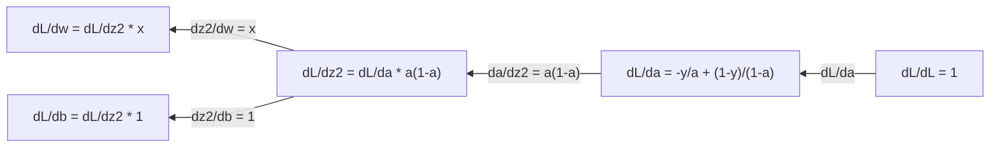
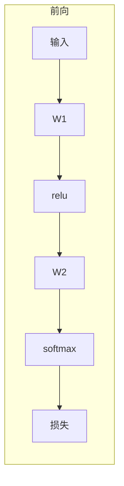
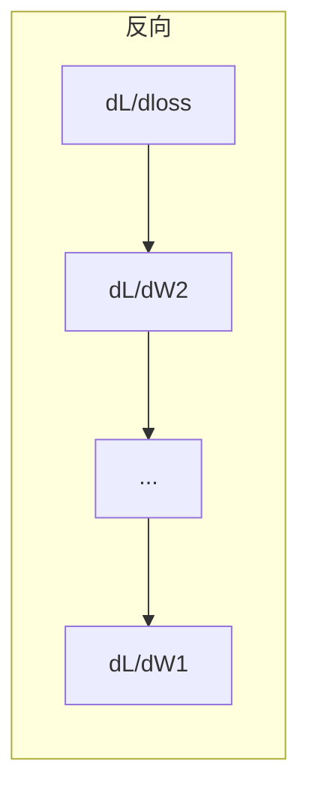

# 机器学习中的微积分

> 导数告诉你哪边是下坡。神经网络学习需要的就是这件事。

**Type:** Learn
**Language:** Python
**Prerequisites:** Phase 1，第 01–03 课
**Time:** ~60 分钟

## 学习目标

- 对机器学习里常见的函数（x^2、sigmoid、交叉熵）计算数值导数和解析导数
- 从零实现梯度下降，在一维和二维上把损失函数降到最低
- 推导线性回归的梯度，并用手写的权重更新把它训练出来
- 说明 Hessian 矩阵、泰勒近似，以及它们和优化方法的关系

## 问题

神经网络有上百万个权重。每个权重是一个旋钮。你要知道每一个旋钮往哪边拧一点，模型才会稍微没那么错。微积分给的就是这个方向。

没有微积分，训练只能随机拧一拧，看误差会不会碰巧变小。有了导数，你知道每个权重怎样影响误差。每一次，每个旋钮都往该拧的方向拧。

## 概念

### 导数是什么

导数量的是变化率。对函数 `y = f(x)`，导数 `f'(x)` 说的是：把 `x` 轻轻推一点，`y` 变多少。

几何上，导数是这一点切线的斜率。

**f(x) = x^2：**

| x | f(x) | f'(x)（斜率） |
|---|------|----------------|
| 0 | 0    | 0（平的，在碗底） |
| 1 | 1    | 2 |
| 2 | 4    | 4（这一点切线的斜率） |
| 3 | 9    | 6 |

在 `x = 2`，斜率是 4。把 `x` 往右推一点点，`y` 大约增加这个推量的 4 倍。在 `x = 0`，斜率是 0。你站在碗底。

正式定义：

```text
f'(x) = lim   f(x + h) - f(x)
        h->0  -----------------
                     h
```

代码里不取这个极限，只取一个很小的 `h`。这就是数值导数。

### 偏导数：一次只动一个变量

真正的函数有很多输入。神经网络的损失依赖成千上万个权重。偏导数把其余变量都按住不动，只对其中一个求导。

```text
f(x, y) = x^2 + 3xy + y^2

df/dx = 2x + 3y     （把 y 当成常数）
df/dy = 3x + 2y     （把 x 当成常数）
```

每一个偏导数回答：只推这一个权重，损失变多少。

### 梯度：全部偏导数排成的向量

梯度把每一个偏导数收进一个向量。对 `f(x, y, z)`：

```text
grad f = [ df/dx, df/dy, df/dz ]
```

梯度指向上升最快的方向。要让函数变小，就往相反方向走。

**f(x, y) = x^2 + y^2 的等高线：**

这个函数是一只碗，等高线是一圈圈的圆。最低点在 `(0, 0)`。

| 点 | grad f | -grad f（下降方向） |
|----|--------|----------------------|
| (1, 1) | [2, 2]（指向上坡，离开最低点） | [-2, -2]（指向下坡，朝向最低点） |
| (0, 0) | [0, 0]（平的，就在最低点） | [0, 0] |

这就是一张图里的梯度下降：算出梯度，取反，走一步。

### 和优化的关系

训练神经网络就是优化。损失函数 `L(w1, w2, ..., wn)` 量模型错多少。你要把它变小。

```text
梯度下降的更新：

  w_new = w_old - learning_rate * dL/dw

对每一个权重：
  1. 算损失对这个权重的偏导数
  2. 从这个权重里减去该导数的一小份
  3. 重复
```

学习率控制步子多大。太大就会跨过最低点。太小就爬得很慢。

**损失曲面的一维切片：**

损失 `L(w)` 随着权重 `w` 变化，形成有峰有谷的曲线。

| 特征 | 含义 |
|------|------|
| 全局最小 | 整条曲线上最低的点，也就是最好的解 |
| 局部最小 | 比邻域都低、但不是全局最低的谷 |
| 斜率 | 梯度下降从任何起点都顺着斜率往下走 |

梯度下降顺着下坡走。它可能停在局部最小。在上百万个权重的高维空间里，这很少成为实际问题。

### 数值导数和解析导数

导数有两种算法。

解析导数：用手把求导规则用上去。`f(x) = x^2` 的导数是 `f'(x) = 2x`。精确，也快。

数值导数：用定义做近似。对很小的 `h` 计算 `f(x+h)` 和 `f(x-h)`，再取差。

```text
数值导数（中心差分）：

f'(x) ~= f(x + h) - f(x - h)
          -----------------------
                  2h

实践里 h = 0.0001 就够用
```

数值导数更慢，但任何函数都能用。解析导数快，但你得先推出公式。神经网络框架用第三种办法：自动微分，用机械的步骤算出精确导数。Phase 3 会看到它。

### 简单函数的手算导数

这些导数在机器学习里会反复出现。

```text
函数            导数              用在哪里
--------        ----------        -------
f(x) = x^2     f'(x) = 2x       损失函数（均方误差）
f(x) = wx + b  f'(w) = x         线性层（对权重的梯度）
                f'(b) = 1         线性层（对偏置的梯度）
                f'(x) = w         线性层（对输入的梯度）
f(x) = e^x     f'(x) = e^x      Softmax、注意力
f(x) = ln(x)   f'(x) = 1/x      交叉熵损失
f(x) = 1/(1+e^-x)  f'(x) = f(x)(1-f(x))   Sigmoid 激活
```

对 `f(x) = x^2`：

```text
f(x) = x^2    f'(x) = 2x

  x    f(x)   f'(x)   含义
  -2    4      -4      切线向左倾（函数在下降）
  -1    1      -2      切线向左倾（函数在下降）
   0    0       0      平的（最低点）
   1    1       2      切线向右倾（函数在上升）
   2    4       4      切线向右倾（函数在上升）
```

对 `f(w) = wx + b`，取 `x = 3`、`b = 1`：

```text
f(w) = 3w + 1    f'(w) = 3

对 w 的导数就是 x。
x 很大时，w 动一点点，输出就动很多。
```

### 链式法则

函数套函数时，链式法则告诉你怎么求导。

```text
若 y = f(g(x))，则 dy/dx = f'(g(x)) * g'(x)

例子：y = (3x + 1)^2
  外层：f(u) = u^2       f'(u) = 2u
  内层：g(x) = 3x + 1    g'(x) = 3
  dy/dx = 2(3x + 1) * 3 = 6(3x + 1)
```

神经网络就是一串套起来的函数：输入 → 线性 → 激活 → 线性 → 激活 → 损失。反向传播就是把链式法则从输出到输入反复用。整个算法就是这件事。

### Hessian 矩阵

梯度告诉你斜率。Hessian 告诉你弯曲程度。

Hessian 是二阶偏导数排成的矩阵。对 `f(x1, x2, ..., xn)`，第 `(i, j)` 项是：

```text
H[i][j] = d^2f / (dx_i * dx_j)
```

两个变量的 `f(x, y)`：

```text
H = | d^2f/dx^2    d^2f/dxdy |
    | d^2f/dydx    d^2f/dy^2 |
```

**梯度为 0 的临界点上，Hessian 说明什么：**

| Hessian 的性质 | 含义 | 曲面例子 |
|----------------|------|----------|
| 正定（特征值全大于 0） | 局部最小 | 开口向上的碗 |
| 负定（特征值全小于 0） | 局部最大 | 开口向下的碗 |
| 不定（特征值有正有负） | 鞍点 | 马鞍 |

**例子：** `f(x, y) = x^2 - y^2`（鞍面）

```text
df/dx = 2x       df/dy = -2y
d^2f/dx^2 = 2    d^2f/dy^2 = -2    d^2f/dxdy = 0

H = | 2   0 |
    | 0  -2 |

特征值：2 和 -2（一正一负）
--> (0, 0) 是鞍点
```

对照 `f(x, y) = x^2 + y^2`（碗）：

```text
H = | 2  0 |
    | 0  2 |

特征值：2 和 2（都是正的）
--> (0, 0) 是局部最小
```

**Hessian 在机器学习里为什么要紧：**

牛顿法用 Hessian 走出比梯度下降更好的步。它不只顺着斜率，还考虑弯曲：

```text
牛顿法更新：    w_new = w_old - H^(-1) * gradient
梯度下降：      w_new = w_old - lr * gradient
```

牛顿法收敛更快，因为 Hessian 把梯度重新缩放：陡的方向步子变小，平的方向步子变大。

代价是：N 个参数的网络，Hessian 是 N×N。100 万个参数就要一万亿个数。所以实际用近似。

| 方法 | 用什么 | 每步代价 | 收敛 |
|------|--------|----------|------|
| 梯度下降 | 只用一阶导数 | O(N) | 慢（线性） |
| 牛顿法 | 完整 Hessian | O(N^3) | 快（二次） |
| L-BFGS | 用梯度历史近似 Hessian | O(N) | 中等（超线性） |
| Adam | 每个参数自己的自适应步长（对角 Hessian 的近似） | O(N) | 中等 |
| 自然梯度 | Fisher 信息矩阵（统计意义上的 Hessian） | O(N^2) | 快 |

实践里，深度学习的默认优化器是 Adam。它记下每个参数梯度的滑动平均和方差，用很低的代价近似二阶信息。

### 泰勒级数近似

任何光滑函数都可以在局部用多项式近似：

```text
f(x + h) = f(x) + f'(x)*h + (1/2)*f''(x)*h^2 + (1/6)*f'''(x)*h^3 + ...
```

项越多，近似越好，但只在 `x` 附近好。

**泰勒级数在机器学习里为什么要紧：**

- **一阶泰勒 = 梯度下降。** 用 `f(x + h) ~ f(x) + f'(x)*h` 时，你在做线性近似。梯度下降去最小化这个线性模型，于是取 `h = -lr * f'(x)`。

- **二阶泰勒 = 牛顿法。** 用 `f(x + h) ~ f(x) + f'(x)*h + (1/2)*f''(x)*h^2`，得到二次模型。把它最小化，得到 `h = -f'(x)/f''(x)`，也就是牛顿步。

- **损失函数的设计。** 均方误差和交叉熵是光滑的，泰勒展开行为规矩。这不是碰巧。光滑的损失让优化可预期。

```text
近似阶数          它抓住什么        优化方法
----------------- ----------------- -------------------
0 阶（常数）      只有函数值        随机搜索
1 阶（线性）      斜率              梯度下降
2 阶（二次）      弯曲              牛顿法
更高阶            更细的结构        机器学习里很少用
```

要点：所有基于梯度的优化，都是在局部近似损失函数，再走到这个近似的最低点。

### 机器学习里的积分

导数说的是变化率。积分算的是累积，也就是曲线下的面积。

机器学习里很少手算积分，但这个概念到处都在：

**概率。** 连续随机变量的密度是 `p(x)`：

```text
P(a < X < b) = 从 a 到 b 对 p(x) 积分
```

密度曲线在 `a` 和 `b` 之间的面积，就是落进这个区间的概率。

**期望。** 用概率加权的平均结果：

```text
E[f(X)] = 对 f(x) * p(x) 积分
```

数据分布上的期望损失是一个积分。训练最小化的是它的经验近似。

**KL 散度。** 量两个分布差多远：

```text
KL(p || q) = 对 p(x) * log(p(x) / q(x)) 积分
```

用在 VAE、知识蒸馏和贝叶斯推断里。

**归一化常数。** 贝叶斯推断里：

```text
p(w | data) = p(data | w) * p(w) / 对 p(data | w) * p(w) 的积分
```

分母是对所有可能参数的积分。它常常算不出来，所以用 MCMC 和变分推断做近似。

| 积分概念 | 在机器学习里出现的地方 |
|----------|------------------------|
| 曲线下面积 | 由密度得到概率 |
| 期望 | 损失函数、风险最小化 |
| KL 散度 | VAE、策略优化、蒸馏 |
| 归一化 | 贝叶斯后验、softmax 的分母 |
| 边际似然 | 模型比较、证据下界（ELBO） |

### 计算图上的多元链式法则

链式法则不只用于排成一条线的标量函数。神经网络里，变量会分叉，也会汇合。一次简单前向里，导数是这样流的：


反向从右往左算梯度：



每一条箭头都乘上局部导数。任何一个参数的梯度，都是从损失走到这个参数的路径上，所有局部导数的乘积。路径分叉再汇合时，把各条贡献加起来。这就是多元链式法则。

反向传播的全部内容就是：把链式法则有系统地用在计算图上，从输出走回输入。

### 雅可比矩阵

函数把向量映成向量时（例如神经网络的一层），它的导数是一张矩阵。雅可比里放着每一个输出对每一个输入的偏导数。

对 `f: R^n -> R^m`，雅可比 `J` 是 `m x n` 矩阵：

| | x1 | x2 | ... | xn |
|---|---|---|---|---|
| f1 | df1/dx1 | df1/dx2 | ... | df1/dxn |
| f2 | df2/dx1 | df2/dx2 | ... | df2/dxn |
| ... | ... | ... | ... | ... |
| fm | dfm/dx1 | dfm/dx2 | ... | dfm/dxn |

神经网络的雅可比不会用手算。PyTorch 会处理。知道它存在，有助于看懂反向传播里的形状：一层把 `R^n` 映到 `R^m`，雅可比就是 `m x n`。梯度往回走时，经过这张矩阵的转置。

### 这对神经网络为什么要紧

神经网络里的每一个权重都有一个梯度。梯度告诉你怎样改这个权重才能减小损失。





每次更新权重：

- `W1 = W1 - lr * dL/dW1`
- `W2 = W2 - lr * dL/dW2`

前向算出预测和损失。反向算出损失对每个权重的梯度。然后每个权重往下坡走一小步。重复上百万步。深度学习就是这件事。

```figure
derivative-tangent
```

## 动手做

### 第 1 步：从零写数值导数

```python
def numerical_derivative(f, x, h=1e-7):
    return (f(x + h) - f(x - h)) / (2 * h)

def f(x):
    return x ** 2

for x in [-2, -1, 0, 1, 2]:
    numerical = numerical_derivative(f, x)
    analytical = 2 * x
    print(f"x={x:2d}  f'(x) numerical={numerical:.6f}  analytical={analytical:.1f}")
```

数值导数和解析导数会在很多位小数上对上。

### 第 2 步：偏导数和梯度

```python
def numerical_gradient(f, point, h=1e-7):
    gradient = []
    for i in range(len(point)):
        point_plus = list(point)
        point_minus = list(point)
        point_plus[i] += h
        point_minus[i] -= h
        partial = (f(point_plus) - f(point_minus)) / (2 * h)
        gradient.append(partial)
    return gradient

def f_multi(point):
    x, y = point
    return x**2 + 3*x*y + y**2

grad = numerical_gradient(f_multi, [1.0, 2.0])
print(f"Numerical gradient at (1,2): {[f'{g:.4f}' for g in grad]}")
print(f"Analytical gradient at (1,2): [2*1+3*2, 3*1+2*2] = [{2*1+3*2}, {3*1+2*2}]")
```

### 第 3 步：用梯度下降找 f(x) = x^2 的最低点

```python
x = 5.0
lr = 0.1
for step in range(20):
    grad = 2 * x
    x = x - lr * grad
    print(f"step {step:2d}  x={x:8.4f}  f(x)={x**2:10.6f}")
```

从 `x = 5` 出发，每一步都更靠近 `x = 0`，也就是最低点。

### 第 4 步：二维函数上的梯度下降

```python
def f_2d(point):
    x, y = point
    return x**2 + y**2

point = [4.0, 3.0]
lr = 0.1
for step in range(30):
    grad = numerical_gradient(f_2d, point)
    point = [p - lr * g for p, g in zip(point, grad)]
    loss = f_2d(point)
    if step % 5 == 0 or step == 29:
        print(f"step {step:2d}  point=({point[0]:7.4f}, {point[1]:7.4f})  f={loss:.6f}")
```

### 第 5 步：比较数值导数和解析导数

```python
import math

test_functions = [
    ("x^2",      lambda x: x**2,          lambda x: 2*x),
    ("x^3",      lambda x: x**3,          lambda x: 3*x**2),
    ("sin(x)",   lambda x: math.sin(x),   lambda x: math.cos(x)),
    ("e^x",      lambda x: math.exp(x),   lambda x: math.exp(x)),
    ("1/x",      lambda x: 1/x,           lambda x: -1/x**2),
]

x = 2.0
print(f"{'Function':<12} {'Numerical':>12} {'Analytical':>12} {'Error':>12}")
print("-" * 50)
for name, f, df in test_functions:
    num = numerical_derivative(f, x)
    ana = df(x)
    err = abs(num - ana)
    print(f"{name:<12} {num:12.6f} {ana:12.6f} {err:12.2e}")
```

### 第 6 步：数值计算 Hessian

```python
def hessian_2d(f, x, y, h=1e-5):
    fxx = (f(x + h, y) - 2 * f(x, y) + f(x - h, y)) / (h ** 2)
    fyy = (f(x, y + h) - 2 * f(x, y) + f(x, y - h)) / (h ** 2)
    fxy = (f(x + h, y + h) - f(x + h, y - h) - f(x - h, y + h) + f(x - h, y - h)) / (4 * h ** 2)
    return [[fxx, fxy], [fxy, fyy]]

def saddle(x, y):
    return x ** 2 - y ** 2

def bowl(x, y):
    return x ** 2 + y ** 2

H_saddle = hessian_2d(saddle, 0.0, 0.0)
H_bowl = hessian_2d(bowl, 0.0, 0.0)
print(f"Saddle Hessian: {H_saddle}")
print(f"Bowl Hessian:   {H_bowl}")
```

鞍面的 Hessian 特征值是 2 和 -2，一正一负，确认是鞍点。碗的特征值是 2 和 2，都是正的，确认是最低点。

### 第 7 步：泰勒近似实际算一次

```python
import math

def taylor_approx(f, f_prime, f_double_prime, x0, h, order=2):
    result = f(x0)
    if order >= 1:
        result += f_prime(x0) * h
    if order >= 2:
        result += 0.5 * f_double_prime(x0) * h ** 2
    return result

x0 = 0.0
for h in [0.1, 0.5, 1.0, 2.0]:
    true_val = math.sin(h)
    t1 = taylor_approx(math.sin, math.cos, lambda x: -math.sin(x), x0, h, order=1)
    t2 = taylor_approx(math.sin, math.cos, lambda x: -math.sin(x), x0, h, order=2)
    print(f"h={h:.1f}  sin(h)={true_val:.4f}  order1={t1:.4f}  order2={t2:.4f}")
```

在 `x0 = 0` 附近，`sin(x) ~ x`，这是一阶泰勒。`h` 很小时代似很好，`h` 很大时就坏了。梯度下降要用小学习率，就是因为每一步都假设这个线性近似还准。

### 第 8 步：这件事对神经网络为什么要紧

```python
import random

random.seed(42)

w = random.gauss(0, 1)
b = random.gauss(0, 1)
lr = 0.01

xs = [1.0, 2.0, 3.0, 4.0, 5.0]
ys = [3.0, 5.0, 7.0, 9.0, 11.0]

for epoch in range(200):
    total_loss = 0
    dw = 0
    db = 0
    for x, y in zip(xs, ys):
        pred = w * x + b
        error = pred - y
        total_loss += error ** 2
        dw += 2 * error * x
        db += 2 * error
    dw /= len(xs)
    db /= len(xs)
    total_loss /= len(xs)
    w -= lr * dw
    b -= lr * db
    if epoch % 40 == 0 or epoch == 199:
        print(f"epoch {epoch:3d}  w={w:.4f}  b={b:.4f}  loss={total_loss:.6f}")

print(f"\nLearned: y = {w:.2f}x + {b:.2f}")
print(f"Actual:  y = 2x + 1")
```

所有基于梯度的训练循环都是这个样子：预测，算损失，算梯度，更新权重。

## 用起来

用 NumPy 时，同一套运算更短，也更快：

```python
import numpy as np

x = np.array([1, 2, 3, 4, 5], dtype=float)
y = np.array([3, 5, 7, 9, 11], dtype=float)

w, b = np.random.randn(), np.random.randn()
lr = 0.01

for epoch in range(200):
    pred = w * x + b
    error = pred - y
    loss = np.mean(error ** 2)
    dw = np.mean(2 * error * x)
    db = np.mean(2 * error)
    w -= lr * dw
    b -= lr * db

print(f"Learned: y = {w:.2f}x + {b:.2f}")
```

你刚刚从零搭了梯度下降。PyTorch 把梯度计算自动化了，更新循环还是这一套。

## 练习

1. 用 `numerical_derivative` 调用两次，实现 `numerical_second_derivative(f, x)`。验证 `x^3` 在 `x = 2` 的二阶导数是 12。
2. 用梯度下降找 `f(x, y) = (x - 3)^2 + (y + 1)^2` 的最低点。从 `(0, 0)` 出发。结果应收敛到 `(3, -1)`。
3. 给梯度下降加上动量：维护一个速度向量，把过去的梯度累加进去。在 `f(x) = x^4 - 3x^2` 上比较有动量和没有动量的收敛速度。

## 术语

| 术语 | 别人怎么说 | 它实际指什么 |
|------|------------|----------------|
| 导数 | 「斜率」 | 函数在一点的变化率。输入变化一个单位时，输出变化多少。 |
| 偏导数 | 「对一个变量求导」 | 其余变量按住不动，只对一个变量求导。 |
| 梯度 | 「最陡的上坡方向」 | 全部偏导数排成的向量。指向函数增加最快的方向。 |
| 梯度下降 | 「往下走」 | 从参数里减去梯度乘学习率，从而减小损失。神经网络训练的核心。 |
| 学习率 | 「步长」 | 控制梯度下降每一步多大的标量。太大就发散，太小就收敛很慢。 |
| 链式法则 | 「把导数乘起来」 | 复合函数的求导规则：`df/dx = df/dg * dg/dx`。反向传播的数学依据。 |
| 雅可比 | 「导数排成的矩阵」 | 函数把向量映成向量时，所有输出对所有输入的偏导数排成的矩阵。 |
| 数值导数 | 「有限差分」 | 在邻近两点计算函数值，用这两点之间的斜率近似导数。 |
| 反向传播 | 「反向模式自动微分」 | 用链式法则从输出一层层算回输入。神经网络就是这样学习的。 |
| Hessian | 「二阶导数矩阵」 | 所有二阶偏导数排成的矩阵。描述函数的弯曲。临界点上 Hessian 正定，就是局部最小。 |
| 泰勒级数 | 「多项式近似」 | 用一点的各阶导数近似附近的函数：`f(x+h) ~ f(x) + f'(x)h + (1/2)f''(x)h^2 + ...`。梯度下降和牛顿法为什么有效，就靠这个。 |
| 积分 | 「曲线下的面积」 | 一个量在一段范围上的累积。机器学习里，积分定义概率、期望和 KL 散度。 |

## 延伸阅读

- [3Blue1Brown：微积分的本质](https://www.3blue1brown.com/topics/calculus)：导数、积分和链式法则的视觉直觉
- [Stanford CS231n：反向传播](https://cs231n.github.io/optimization-2/)：梯度怎样流过神经网络的各层
