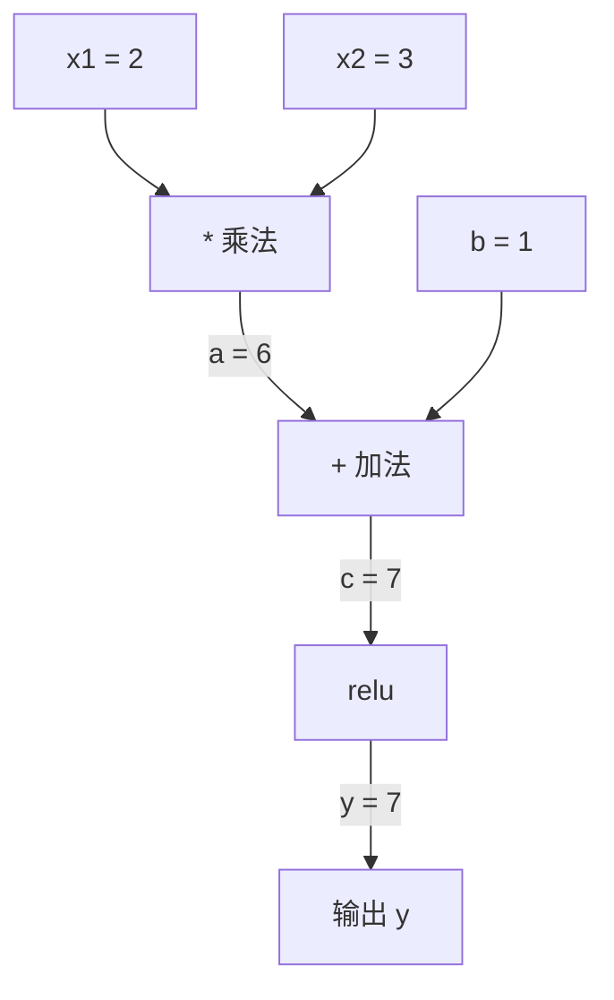
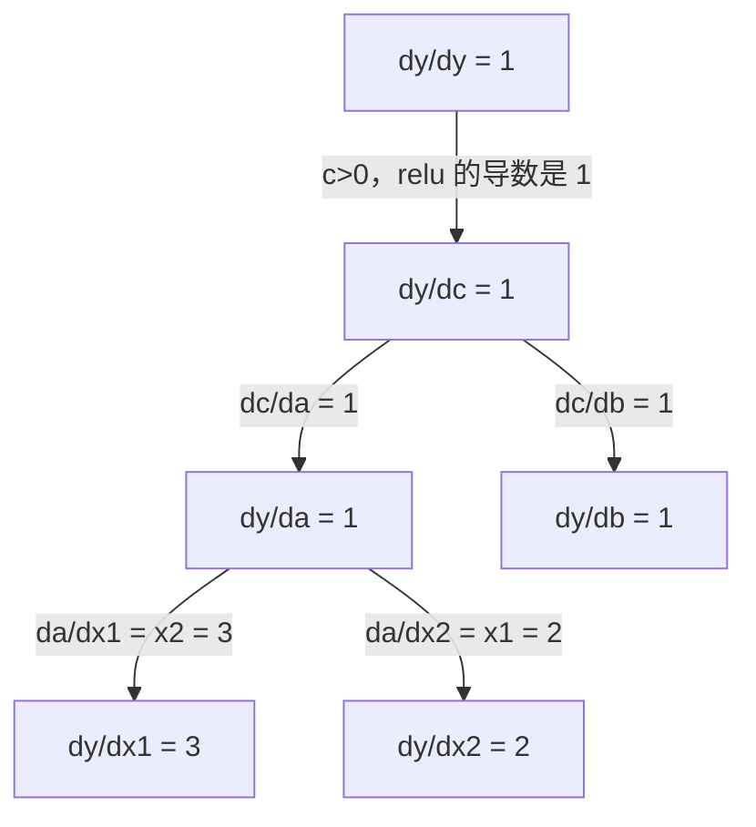

# 链式法则与自动微分

> 链式法则是每一个会学习的神经网络背后的引擎。

**Type:** Build
**Language:** Python
**Prerequisites:** Phase 1，第 04 课（导数与梯度）
**Time:** ~90 分钟

## 学习目标

- 写一个最小的自动求导引擎（`Value` 类）：记下运算，再用反向模式算出梯度
- 用拓扑排序实现计算图上的前向和反向
- 只用这个手写引擎搭一个多层感知机，并在 XOR 上训练
- 用数值差分做梯度检查，核对自动微分是否正确

## 问题

简单函数的导数你已经会算。神经网络不是一个简单函数。它是几百个函数套在一起：矩阵乘、加偏置、激活、再矩阵乘、softmax、交叉熵。输出是函数的函数的函数。

训练需要损失对每一个权重的梯度。上百万个参数没法手推。用有限差分去探，又太慢。

链式法则给出乘法规则。自动微分把这规则做成算法。任意一层套一层的函数，精确梯度的代价大约是一次前向。

PyTorch、TensorFlow、JAX 都是这样做的。这一课写一个缩小版。

## 概念

### 链式法则

`y = f(g(x))` 时，`y` 对 `x` 的导数是：

```text
dy/dx = dy/dg * dg/dx = f'(g(x)) * g'(x)
```

沿着链条把局部导数乘起来。每一环只贡献自己的那一份。

例子：`y = sin(x²)`

```text
g(x) = x²         g'(x) = 2x
f(g) = sin(g)     f'(g) = cos(g)

dy/dx = cos(x²) * 2x
```

套得更深时，链条跟着变长：

```text
y = f(g(h(x)))
dy/dx = f'(g(h(x))) * g'(h(x)) * h'(x)
```

网络里的每一层就是链条上的一环。

### 计算图

计算图把链式法则画出来。每个运算是一个节点。数据向前流，梯度向后流。

**前向（算值）：**



**反向（算梯度）：**



反向在每个节点用一次链式法则，把梯度从输出送回输入。

### 前向模式和反向模式

链条可以有两种走法。

**前向模式**从输入出发，把导数往前推。先放 `dx/dx = 1`，再穿过每个运算。输入少、输出多时合适。

```text
前向模式：种子 dx/dx = 1，向前传

  x = 2       （dx/dx = 1）
  a = x²      （da/dx = 2x = 4）
  y = sin(a)  （dy/dx = cos(a) * da/dx = cos(4) * 4）
```

**反向模式**从输出出发，把梯度往回拉。先放 `dy/dy = 1`，再按相反顺序穿过每个运算。输入多、输出少时合适。

```text
反向模式：种子 dy/dy = 1，向后传

  y = sin(a)  （dy/dy = 1）
  a = x²      （dy/da = cos(a) = cos(4)）
  x = 2       （dy/dx = dy/da * da/dx = cos(4) * 4）
```

两种走法得到同一个 `dy/dx`。神经网络有上百万个输入（权重），输出却是一个损失。反向模式一次反向就能得到全部梯度。反向传播用的就是反向模式。

| 模式 | 种子 | 方向 | 适合 |
|------|------|------|------|
| 前向 | `dx_i/dx_i = 1` | 从输入到输出 | 输入少、输出多 |
| 反向 | `dy/dy = 1` | 从输出到输入 | 输入多、输出少（神经网络） |

### 前向模式用的对偶数

前向模式可以用对偶数写得很短。一个对偶数是 `a + b·ε`，并且 `ε² = 0`。

```text
对偶数：（值，导数）

(2, 1) 表示：值是 2，对 x 的导数是 1

运算规则：
  (a, a') + (b, b') = (a+b, a'+b')
  (a, a') * (b, b') = (a*b, a'*b + a*b')
  sin(a, a')        = (sin(a), cos(a)*a')
```

把要求导的那个输入的导数设成 1。导数会跟着每次运算自己往前走。

### 自动求导引擎要有的三件事

1. **把数包起来。** 每个数放进一个对象，对象里有值和梯度。
2. **把图记下来。** 每次运算记下输入，以及局部梯度怎么算。
3. **反向。** 先拓扑排序，再倒着走，每个节点乘一次链式法则。

PyTorch 的 `autograd` 就是这三件事。`torch.Tensor` 包住值。`requires_grad=True` 时记下运算。`.backward()` 算出梯度。

### PyTorch 内部在做什么

```python
x = torch.tensor(2.0, requires_grad=True)
y = x ** 2 + 3 * x + 1
y.backward()
print(x.grad)  # 7.0 = 2*x + 3 = 4 + 3
```

内部步骤：

1. 为 `x` 建一个 `requires_grad=True` 的节点。
2. 每一次 `**`、`*`、`+` 都新建节点，并记下反向函数。
3. `y.backward()` 沿着记下的图做反向模式。
4. 每个节点的 `grad_fn` 算局部梯度，传给父节点。
5. 梯度用加法累进 `.grad`，不是覆盖。

这张图是动态的：每次前向现建一张。所以模型里面可以写 `if` 和循环。

```figure
chain-rule
```

## 动手做

代码分步写在 `code/learn_autodiff.py`。官方的 `autodiff.py` 留着对照。下面各步的类方法都写在 `Value` 里面。

### 第 1 步：Value 类

每个 `Value` 存四个东西：数 `data`、梯度 `grad`（一开始是 0）、反向函数 `_backward`、以及生出它的那些子节点 `_prev`。

### 第 2 步：加减乘和 relu 记下梯度

加法的反向：上游梯度原样加到两个输入上，因为 `d(a+b)/da = 1`。

乘法的反向：每个输入得到「另一个输入的值 × 上游梯度」。`d(a*b)/da = b`。

`+=` 不是随便写的。同一个值若被用了两次，两路梯度都要留下。写成 `=` 会把先到的那一路盖掉。

relu 的反向：输出大于 0 时，上游梯度原样传回；否则传 0。

### 第 3 步：backward

先从输出往子节点做深度优先，一个节点的孩子都访问完才把自己放进列表。这就是拓扑排序：用到的数排在用它的运算前面。然后把输出的梯度设成 `1`（`dy/dy = 1`），再倒着对每个节点调用 `_backward`。

### 第 4 步：减、幂、除、exp、log、tanh

减法和除法不用新写反向。减法是加上相反数，除法是乘上 `**-1`。梯度会顺着已经写好的加法和乘法自己流回去。

幂的反向是 `n * x^(n-1) * 上游梯度`。`exp` 的反向是 `exp(x) * 上游梯度`。`log` 的反向是 `(1/x) * 上游梯度`。`tanh` 的反向是 `(1 - tanh²) * 上游梯度`。

### 第 5 步：用手写引擎训练 XOR

一个神经元是 `tanh(w·x + b)`。一层是若干神经元。多层感知机把层叠起来。每个权重都是 `Value`。`loss.backward()` 会把梯度送到每一个参数。

XOR 用 `-1/1` 当目标，因为 `tanh` 的输出在 `-1` 和 `1` 之间。每次反向之前把 `grad` 清零，否则梯度会累加到上一轮上面。

### 第 6 步：梯度检查

自动微分的梯度，和 `(f(x+h) - f(x-h)) / (2h)` 比。差应小于 `1e-5`。加新运算、或者训练不收敛时做这件事。正式训练时不做，因为每个参数都要额外两次前向。

### 第 7 步：和手算核对

`y = relu(2 * 3 + 1) = relu(7) = 7`。relu 在这里是恒等。`dy/dx1 = x2 = 3`，`dy/dx2 = x1 = 2`。引擎打出的梯度应和这两个数一样。

## 用起来

同一张图交给 PyTorch：`requires_grad=True`，乘、加、`relu`，再 `backward()`。`x1.grad` 仍是 `3`，`x2.grad` 仍是 `2`。数学是同一条反向模式，所以数相同。

再算 `relu(2 * -3 + 10) = relu(4) = 4`。对 `a=2` 的梯度是 `-3`，对 `b=-3` 的梯度是 `2`，对 `c=10` 的梯度是 `1`。

## 带走的东西

这一课给出 `outputs/skill-autodiff.md`，以及可扩展的 `code/autodiff.py`。这里的 `Value` 是后面 Phase 3 训练循环的底子。

## 练习

1. 给 `Value` 加上 `__pow__`。验证 `x³` 在 `x = 2` 的导数是 `12.0`。
2. 加上 `tanh`。验证 `tanh'(0) = 1`，`tanh'(2)` 大约是 `0.0707`。
3. 搭一个神经元 `y = relu(w1*x1 + w2*x2 + b)`，算出五个梯度，再和 PyTorch 对。
4. 用对偶数做前向模式。`Dual` 类算出的导数应和反向引擎一致。

## 术语

| 术语 | 别人怎么说 | 它实际指什么 |
|------|------------|----------------|
| 链式法则 | 「把导数乘起来」 | 复合函数的导数等于各层局部导数的乘积，而且每一层要代在正确的点上 |
| 计算图 | 「网络那张图」 | 有向无环图。节点是运算。边上前向传值，反向传梯度 |
| 前向模式 | 「把导数往前推」 | 从输入把导数传到输出。每个输入变量走一遍 |
| 反向模式 | 「反向传播」 | 从输出把梯度传到输入。每个输出变量走一遍 |
| 自动求导 | 「自动梯度」 | 记下运算、建成图，再用链式法则算出精确梯度 |
| 对偶数 | 「值加上导数」 | `a + b·ε`，且 `ε² = 0`。算术带着导数一起走 |
| 拓扑排序 | 「依赖顺序」 | 每个节点排在它依赖的节点之后。梯度要按这个顺序倒着传 |
| 梯度累加 | 「加，不要盖」 | 一个值喂进多个运算时，梯度是各路贡献的和 |
| 动态图 | 「跑的时候再建」 | 每次前向重建计算图，模型里可以写 Python 的控制流。PyTorch 是这种 |
| 梯度检查 | 「用数值核对」 | 把自动微分的梯度和有限差分比一比。调试时要用 |
| 多层感知机 | 「带隐藏层的网络」 | 一层或多层神经元。每个神经元是加权和加偏置，再过激活 |
| 神经元 | 「加权和再激活」 | `输出 = 激活(w1*x1 + w2*x2 + ... + b)`。权重和偏置是要学的参数 |

## 延伸阅读

- [3Blue1Brown：反向传播的微积分](https://www.youtube.com/watch?v=tIeHLnjs5U8)：链式法则在网络里的视觉讲解
- [PyTorch Autograd 机制](https://pytorch.org/docs/stable/notes/autograd.html)：真实系统怎么做
- [Baydin 等人，机器学习中的自动微分综述](https://arxiv.org/abs/1502.05767)
