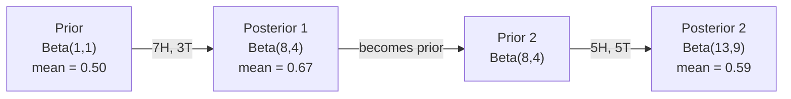

# 贝叶斯定理（Bayes' Theorem）

> 概率论研究的是你预期会发生什么；贝叶斯定理研究的是你在观察之后学到了什么。

**课程类型：** 动手构建（Build）  
**编程语言：** Python  
**先修课程：** Phase 1，第 06 课（概率基础）  
**预计用时：** 约 75 分钟

> **中文版说明：** 这是官方 `docs/en.md` 的全节简体中文译本。所有数学公式、Python 示例、Mermaid 图示和实验数据保留原始形式，确保与官方代码一致。教程的代码练习、拓展章节、提示、术语表和参考资料均未省略；译者补充说明用“译注”标明。英文原文另存于本目录的 `en.md`。

## 学习目标

- 运用贝叶斯定理，从先验概率、似然和证据计算后验概率。
- 从零实现朴素贝叶斯文本分类器，掌握拉普拉斯平滑与对数空间运算。
- 比较最大似然估计（MLE）与最大后验估计（MAP），理解 MAP 与 L2 正则化的对应关系。
- 用 Beta–Binomial 共轭先验实现顺序贝叶斯更新，并应用于 A/B 测试。

## 问题（The Problem）

假设某项医学检测的准确率为 99%。你的检测结果是阳性。那么，你实际上患病的概率是多少？

多数人会回答 99%。但真正的答案取决于疾病有多罕见。如果每一万人中仅有一人患病，那么即使检测结果为阳性，实际患病概率也只有大约 1%。在所有阳性结果中，其余大约 99% 都是来自健康人的误报。

这不是故意刁难的问题，而是贝叶斯定理的应用。垃圾邮件过滤、医学诊断以及量化预测不确定性的机器学习系统都使用这种推理方式：从既有信念出发，观察证据，然后修正判断。

如果在构建机器学习系统时缺乏这种认识，就可能误解模型输出、设置不合理的阈值，最终给出过于自信的预测。

> **译注：** “准确率 99%”不能单独确定这个后验概率。下文算例明确使用**灵敏度为 99%**、**健康人假阳性率为 1%**两项条件。

## 概念（The Concept）

### 从联合概率推导贝叶斯定理

上一课已经学过，条件概率可以表示为：

```math
P(A \mid B) = \frac{P(A \text{ and } B)}{P(B)}
```

对称地，还有：

```math
P(B \mid A) = \frac{P(A \text{ and } B)}{P(A)}
```

两个公式共享同一个分子：$P(A \text{ and } B)$，即事件 $A$ 与 $B$ 同时发生的概率。让两个表达式相等，重新整理：

```math
\begin{aligned}
P(A \text{ and } B) &= P(A \mid B) \cdot P(B) = P(B \mid A) \cdot P(A) \\[4pt]
&\text{Therefore:} \\[4pt]
P(A \mid B) &= \frac{P(B \mid A) \cdot P(A)}{P(B)}
\end{aligned}
```

这就是贝叶斯定理：一个等式关联四个概率量。

### 公式的四个部分

| 数学符号 | 名称 | 含义 |
|----------|------|------|
| $P(A \mid B)$ | 后验概率（Posterior） | 观察证据 $B$ 之后，对假设 $A$ 的更新判断 |
| $P(B \mid A)$ | 似然（Likelihood） | 假如 $A$ 为真，观察到证据 $B$ 有多大可能 |
| $P(A)$ | 先验概率（Prior） | 还未观察到当前证据时，对 $A$ 的初始判断 |
| $P(B)$ | 证据（Evidence） | 在所有可能情况下观察到 $B$ 的总概率 |

证据项 $P(B)$ 承担归一化因子的角色。利用全概率公式，可以展开为：

```math
P(B) = P(B \mid A) \cdot P(A) + P(B \mid \text{not } A) \cdot P(\text{not } A)
```

### 医学检测示例

某种疾病的患病率是每一万人一例。检测的“准确率”为 99%：它能够检出 99% 的患者，而对健康人产生假阳性的概率是 1%。

```math
\begin{aligned}
P(\text{sick}) &= 0.0001 \quad \text{(prior: disease is rare)} \\
P(\text{positive} \mid \text{sick}) &= 0.99 \quad \text{(likelihood: test catches it)} \\
P(\text{positive} \mid \text{healthy}) &= 0.01 \quad \text{(false positive rate)} \\[6pt]
P(\text{positive}) &= P(\text{positive} \mid \text{sick}) \cdot P(\text{sick}) + P(\text{positive} \mid \text{healthy}) \cdot P(\text{healthy}) \\
&= 0.99 \cdot 0.0001 + 0.01 \cdot 0.9999 \\
&= 0.000099 + 0.009999 \\
&= 0.010098 \\[6pt]
P(\text{sick} \mid \text{positive}) &= P(\text{positive} \mid \text{sick}) \cdot P(\text{sick}) / P(\text{positive}) \\
&= 0.99 \cdot 0.0001 / 0.010098 \\
&= 0.0098 \\
&= 0.98\%
\end{aligned}
```

结果低于 1%。疾病极其罕见这一先验信息，显著影响了结果。当疾病很少见时，即使检测较为准确，阳性结果也很可能是误报。这也是医生通常还要安排复查或确诊检测的原因。

### 垃圾邮件过滤示例

你收到了一封包含单词“lottery”（彩票）的电子邮件。这封邮件是垃圾邮件吗？

```math
\begin{aligned}
P(\text{spam}) &= 0.3 \quad \text{(30\% of email is spam)} \\
P(\text{"lottery"} \mid \text{spam}) &= 0.05 \quad \text{(5\% of spam emails contain "lottery")} \\
P(\text{"lottery"} \mid \text{not spam}) &= 0.001 \quad \text{(0.1\% of legitimate emails contain "lottery")} \\[6pt]
P(\text{"lottery"}) &= 0.05 \cdot 0.3 + 0.001 \cdot 0.7 \\
&= 0.015 + 0.0007 \\
&= 0.0157 \\[6pt]
P(\text{spam} \mid \text{"lottery"}) &= 0.05 \cdot 0.3 / 0.0157 \\
&= 0.955 \\
&= 95.5\%
\end{aligned}
```

一个单词就让“垃圾邮件”的概率从 30% 提升到大约 95.5%。实际的垃圾邮件过滤器会对几百个词同时采用贝叶斯推断。

### 朴素贝叶斯：独立性假设

朴素贝叶斯（Naive Bayes）将这种推理扩展到多个特征，假设：**当类别给定时，所有特征在条件上相互独立**。

```math
P(\text{class} \mid \text{feature}_1, \text{feature}_2, \ldots, \text{feature}_n) = \frac{P(\text{class}) \cdot P(\text{feature}_1 \mid \text{class}) \cdot P(\text{feature}_2 \mid \text{class}) \cdots P(\text{feature}_n \mid \text{class})}{P(\text{feature}_1, \text{feature}_2, \ldots, \text{feature}_n)}
```

“朴素”指的就是这个独立性假设。在文本中，单词的出现通常并不独立（例如“New”和“York”高度相关）。但即便这一假设不严格成立，朴素贝叶斯在实践中仍可能表现得很好，因为分类器经常只需正确比较类别排序，并不一定要求预测概率本身完美校准。

对所有候选类别来说，分母相同，因此比较类别时可以忽略分母、只比较分子：

```math
\text{score}(\text{class}) = P(\text{class}) \cdot \prod_i P(\text{feature}_i \mid \text{class})
```

选择分数最高的类别。

### 最大似然估计（MLE）

怎样从训练数据中获得 $P(\text{feature}\mid\text{class})$？最直接的办法就是计数。

```math
P(\text{"free"} \mid \text{spam}) = \frac{\text{number of spam emails containing "free"}}{\text{total spam emails}}
```

这就是最大似然估计（Maximum Likelihood Estimation, MLE）：寻找一组参数，使已经观察到的数据最有可能出现；在离散计数问题中，常常表现为使用相对频率。

但存在一个问题：如果某个单词在训练垃圾邮件中从来没有出现过，MLE 就会把它在垃圾邮件条件下的概率估计为零。一个未见过的单词便可能让整个概率乘积归零。可以用拉普拉斯平滑解决：

```math
P(\text{word} \mid \text{class}) = \frac{\text{count}(\text{word}, \text{class}) + 1}{\text{total\_words\_in\_class} + \text{vocabulary\_size}}
```

给每个单词的计数加 1，就能避免由于训练样本中的零计数而把概率估计为零。

> **译注：** 上一条“包含单词的邮件数 / 邮件总数”描述的是文档出现率；这里及配套 `NaiveBayes` 的词计数公式对应多项式文本模型（token 总计数），两者使用的统计口径不同，不应直接混用。

### 最大后验估计（MAP）

MLE 要解决的问题是：哪一组参数让 $P(\text{data}\mid\text{parameters})$ 最大？

MAP 要解决的是：在观察到数据之后，哪一组参数让 $P(\text{parameters}\mid\text{data})$ 最大？

根据贝叶斯定理：

```math
P(\text{parameters} \mid \text{data}) \propto P(\text{data} \mid \text{parameters}) \cdot P(\text{parameters})
```

MAP 不只考虑观测数据的似然，还为参数引入先验分布。如果你认为参数应该偏小，可以选取抑制大参数的先验。这与机器学习中的正则化相对应。例如，岭回归中的 L2 惩罚可以解释为给模型权重设置一个零均值的高斯先验。

| 估计方法 | 优化目标 | 在机器学习中的对应 |
|----------|----------|-------------------|
| MLE | $P(\text{data} \mid \text{params})$ | 不加入显式先验的训练 |
| MAP | $P(\text{data} \mid \text{params})\cdot P(\text{params})$ | 可对应 L2 / L1 正则化 |

> **译注：** 并不是任何 MAP 都等价于 L2；高斯先验对应 L2、拉普拉斯先验对应 L1，而其他先验可能产生其他形式的正则项。

### 贝叶斯学派与频率学派：实践中的差别

频率学派把模型参数视作固定但未知的量，提出的问题是：“如果将同一个实验重复无数次，可能发生什么？”

贝叶斯学派通过概率分布来描述未知参数的不确定性，提出的问题是：“基于已经观察到的数据，我现在应该怎样认识这些参数？”

构建 ML 系统时的主要差别：

| 维度 | 频率学派 | 贝叶斯学派 |
|------|----------|------------|
| 输出 | 参数的点估计 | 参数取值的概率分布 |
| 不确定性 | 置信区间（从重复使用的统计程序解释） | 可信区间（从参数的后验概率解释） |
| 小样本 | 容易出现过拟合风险 | 先验能起正则化作用 |
| 计算成本 | 通常较快 | 常常需要采样（MCMC）等方法 |

许多生产环境 ML 使用基于点估计的训练方法（例如 SGD 优化一组参数）。当必须表达不确定性（如医学、安全关键系统），或者训练数据很少（如少样本、冷启动），贝叶斯方法尤其有价值。

### 贝叶斯思想对 ML 的重要性

它与机器学习的联系绝不是表面上的类比。

**先验与正则化。** 高斯权重先验对应 L2，拉普拉斯先验对应 L1。加入正则项，可以被解释为表达“哪些参数值更合理”的先验偏好。

**后验与不确定性。** 单独给出一个预测概率，未必能表达我们对这个数值本身有多确定。贝叶斯方法可以给出参数分布，例如：“我估计垃圾邮件比例位于 0.80 至 0.95 之间。”

**贝叶斯更新与在线学习。** 今天的后验可以成为明天的先验。新数据到来时，可以增量更新判断，不必每次重新处理全部历史数据。

**贝叶斯模型比较。** 贝叶斯信息准则（BIC）、边际似然与贝叶斯因子，都和利用观测证据选择模型、避免过拟合有关。

```figure
bayes-update
```

## 动手构建（Build It）

### 第 1 步：贝叶斯定理函数

```python
def bayes(prior, likelihood, false_positive_rate):
    evidence = likelihood * prior + false_positive_rate * (1 - prior)
    posterior = likelihood * prior / evidence
    return posterior

result = bayes(prior=0.0001, likelihood=0.99, false_positive_rate=0.01)
print(f"P(sick|positive) = {result:.4f}")
```

### 第 2 步：朴素贝叶斯分类器

```python
import math
from collections import defaultdict

class NaiveBayes:
    def __init__(self, smoothing=1.0):
        self.smoothing = smoothing
        self.class_counts = defaultdict(int)
        self.word_counts = defaultdict(lambda: defaultdict(int))
        self.class_word_totals = defaultdict(int)
        self.vocab = set()

    def train(self, documents, labels):
        for doc, label in zip(documents, labels):
            self.class_counts[label] += 1
            words = doc.lower().split()
            for word in words:
                self.word_counts[label][word] += 1
                self.class_word_totals[label] += 1
                self.vocab.add(word)

    def predict(self, document):
        words = document.lower().split()
        total_docs = sum(self.class_counts.values())
        vocab_size = len(self.vocab)
        best_class = None
        best_score = float("-inf")
        for cls in self.class_counts:
            score = math.log(self.class_counts[cls] / total_docs)
            for word in words:
                count = self.word_counts[cls].get(word, 0)
                total = self.class_word_totals[cls]
                score += math.log((count + self.smoothing) / (total + self.smoothing * vocab_size))
            if score > best_score:
                best_score = score
                best_class = cls
        return best_class
```

对数概率能防止下溢。许多很小的概率连续相乘，数值可能小到普通浮点无法表示；改为在对数域逐项求和，数学上等价，数值表现更稳定。

### 第 3 步：使用垃圾邮件样本训练

```python
train_docs = [
    "win free money now",
    "free lottery ticket winner",
    "claim your prize today free",
    "urgent offer free cash",
    "congratulations you won free",
    "meeting tomorrow at noon",
    "project update attached",
    "can we schedule a call",
    "quarterly report review",
    "lunch on thursday sounds good",
    "team standup notes attached",
    "please review the pull request",
]

train_labels = [
    "spam", "spam", "spam", "spam", "spam",
    "ham", "ham", "ham", "ham", "ham", "ham", "ham",
]

classifier = NaiveBayes()
classifier.train(train_docs, train_labels)

test_messages = [
    "free money waiting for you",
    "meeting rescheduled to friday",
    "you won a free prize",
    "please review the attached report",
]

for msg in test_messages:
    print(f"  '{msg}' -> {classifier.predict(msg)}")
```

### 第 4 步：检查模型学到的词概率

```python
def show_top_words(classifier, cls, n=5):
    vocab_size = len(classifier.vocab)
    total = classifier.class_word_totals[cls]
    probs = {}
    for word in classifier.vocab:
        count = classifier.word_counts[cls].get(word, 0)
        probs[word] = (count + classifier.smoothing) / (total + classifier.smoothing * vocab_size)
    sorted_words = sorted(probs.items(), key=lambda x: x[1], reverse=True)
    for word, prob in sorted_words[:n]:
        print(f"    {word}: {prob:.4f}")

print("\nTop spam words:")
show_top_words(classifier, "spam")
print("\nTop ham words:")
show_top_words(classifier, "ham")
```

## 使用成熟框架（Use It）

Scikit-learn 提供了可用于实际项目的朴素贝叶斯实现：

```python
from sklearn.feature_extraction.text import CountVectorizer
from sklearn.naive_bayes import MultinomialNB
from sklearn.metrics import classification_report

vectorizer = CountVectorizer()
X_train = vectorizer.fit_transform(train_docs)
clf = MultinomialNB()
clf.fit(X_train, train_labels)

X_test = vectorizer.transform(test_messages)
predictions = clf.predict(X_test)
for msg, pred in zip(test_messages, predictions):
    print(f"  '{msg}' -> {pred}")
```

算法思路相同。`CountVectorizer` 负责分词和构建词汇表；`MultinomialNB` 负责平滑与对数概率计算。我们在前面使用约 40 行核心代码实现了类似功能。

## 完成并交付（Ship It）

本节构建的 `NaiveBayes` 类演示了从分词、拉普拉斯平滑的概率估计到在 log 域分类的完整流程。配套的 `code/bayes.py` 可以只用 Python 标准库运行，无需额外安装依赖。

### 共轭先验（Conjugate Priors）

如果先验和后验属于同一个概率分布族，这样的先验称作**共轭先验**。它使贝叶斯更新在代数层面非常简单：不需要数值积分，便可以获得有封闭形式的后验。

| 似然分布 | 共轭先验 | 后验形式 | 例子 |
|----------|----------|----------|------|
| Bernoulli | $\text{Beta}(a,b)$ | $\text{Beta}(a+\text{successes},b+\text{failures})$ | 估计硬币的偏向 |
| Normal（方差已知） | $\text{Normal}(\mu_0,\sigma_0)$ | Normal（加权均值、更小方差） | 传感器校准 |
| Poisson | $\text{Gamma}(a,b)$ | $\text{Gamma}(a+\text{sum of counts},b+n)$ | 事件到达速率 |
| Multinomial | $\text{Dirichlet}(\alpha)$ | $\text{Dirichlet}(\alpha+\text{counts})$ | 主题模型、语言模型 |

它为什么重要？如果没有合适的共轭先验，求后验可能需要蒙特卡洛采样或变分推断进行近似；如果存在共轭先验，很多问题只要更新少数几个参数。

Beta 分布是最常见的共轭先验之一。`Beta(a,b)` 描述我们对一个未知概率参数的认识，其均值为 $a/(a+b)$。通常参数总和 $a+b$ 越大，分布越集中，表示越有信心。

Beta 先验的特殊情形：

- $\text{Beta}(1,1)$：均匀分布，对概率参数没有特别的偏好。
- $\text{Beta}(10,10)$：在 0.5 周围更尖锐，强烈认为概率参数在 0.5 附近。
- $\text{Beta}(1,10)$：偏向较小的概率参数，认为它更接近 0。

更新规则非常简单：

```math
\begin{aligned}
\text{Prior:} \quad & \text{Beta}(a, b) \\
\text{Data:} \quad & s \text{ successes}, f \text{ failures} \\
\text{Posterior:} \quad & \text{Beta}(a + s, b + f)
\end{aligned}
```

不需要积分，也不需要采样——直接相加就可以。

### 顺序贝叶斯更新（Sequential Bayesian Updating）

贝叶斯推断天然适合顺序更新：今天的后验成为明天的先验。真实系统可以据此增量学习，不必每次都重新处理全部历史数据。

来看“如何判断硬币是否公平”的具体例子。

**第 1 天：还没有任何数据。**  
从 $\text{Beta}(1,1)$ 均匀先验开始，对参数没有特别偏好。
- 先验均值：0.5
- 在区间 [0,1] 上先验密度是平坦的

**第 2 天：观察到 7 次正面、3 次反面。**  
后验 $=\text{Beta}(1+7,1+3)=\text{Beta}(8,4)$。
- 后验均值：$8/12\approx0.667$
- 数据暗示硬币更容易出现正面

**第 3 天：再观察到 5 次正面、5 次反面。**  
把昨天的后验当作今天的先验。  
后验 $=\text{Beta}(8+5,4+5)=\text{Beta}(13,9)$。
- 后验均值：$13/22\approx0.591$
- 新增的均衡数据把估计拉回接近 0.5 的方向



观测数据的顺序不影响最终结果。从 $\text{Beta}(1,1)$ 出发，一次性用全部 12 次正面和 8 次反面更新，也会得到 $\text{Beta}(13,9)$。顺序更新与批量更新在这种模型下是数学等价的，但顺序更新允许系统在每个阶段作出决策，而不必保留所有原始记录。

这构成了生产环境中在线学习的一个基础模式。用于多臂老虎机问题的汤普森采样（Thompson Sampling）、增量推荐以及流式异常检测，都可以运用类似思路。

### 与 A/B 测试的联系

A/B 测试也可以看成贝叶斯推断。

假设正在测试两种按钮颜色：A 是蓝色，B 是绿色。你希望判断哪种颜色更容易带来点击。

贝叶斯 A/B 测试流程：

1. **先验。** 对两个版本都采用 $\text{Beta}(1,1)$，没有事先偏好。
2. **数据。** A：1000 次展示、50 次点击；B：1000 次展示、65 次点击。
3. **后验。**
   - A：$\text{Beta}(1+50,1+950)=\text{Beta}(51,951)$；后验均值约 0.051。
   - B：$\text{Beta}(1+65,1+935)=\text{Beta}(66,936)$；后验均值约 0.066。
4. **决策。** 计算 $P(B>A)$——B 的真实转化率高于 A 的概率。

直接解析计算 $P(B>A)$ 可能比较复杂，但使用蒙特卡洛模拟很容易：

```
1. Draw 100,000 samples from Beta(51, 951)  -> samples_A
2. Draw 100,000 samples from Beta(66, 936)  -> samples_B
3. P(B > A) = fraction of samples where B > A
```

如果 $P(B>A)>0.95$，部署 B；如果处于 0.05 到 0.95 之间，则继续收集数据；如果 $P(B>A)<0.05$，则部署 A。

与频率学派 A/B 测试相比，书中列出的优势有：

- 能直接给出概率陈述，例如“B 更好的概率为 97%”。
- 不必纠结 p 值的解释或“未能拒绝零假设”的表达。
- 在恰当设定先验并正确指定统计模型时，可以随时查看后验，而不像传统频率学派反复进行未校正的显著性检验那样产生相同的多次窥视问题。
- 可以纳入已有知识（例如历史测试显示转化率通常在 3%–8% 之间）。

| 维度 | 频率学派 A/B | 贝叶斯 A/B |
|------|--------------|------------|
| 输出 | p 值 | $P(B>A)$ |
| 解释 | “如果 A=B，当前数据有多反常？” | “根据现有证据，B 更好的概率是多少？” |
| 提前停止 | 未校正的重复查看会增加假阳性风险 | 在合理先验及正确模型下，可基于预定决策规则动态判断 |
| 先验信息 | 通常不直接使用先验 | 通过 Beta 先验编码 |
| 决策规则 | $p<0.05$ | $P(B>A)>\text{阈值}$ |

> **译注：** “贝叶斯 A/B 可以在任何时点安全停止”并非无条件的统计保证。是否适合提前终止，仍取决于模型、先验选择、损失函数与事先规定的决策过程；不能把这一表述解读为“任意反复窥探都没有后果”。

## 练习（Exercises）

1. **多次检测。** 某患者进行了两次相互独立的检测，两次都呈阳性（检测灵敏度 99%、假阳性率 1%，患病率为万分之一）。在连续两次阳性之后，$P(\text{sick})$ 是多少？将第一次检测的后验用作第二次的先验。
2. **平滑的影响。** 将垃圾邮件分类器的 `smoothing` 分别设为 0.01、0.1、1.0 和 10.0。排序靠前的单词概率会如何改变？如果设置 `smoothing=0`，而某个词只出现于正常邮件（ham）中，会发生什么？
3. **增加特征。** 扩展 `NaiveBayes` 类：除了词计数，还加入邮件长度（短/长）这一特征。根据训练数据估计 $P(\text{short}\mid\text{spam})$ 和 $P(\text{short}\mid\text{ham})$，并将其纳入预测分数。
4. **手算 MAP。** 观测到 10 次抛硬币中有 7 次正面，使用 $\text{Beta}(2,2)$ 先验求硬币正面概率的 MAP 估计，并与 MLE $7/10$ 比较。

### 提示（Hints）

**练习 1。** 第一次调用 `bayes` 得到后验，再将该后验作为先验调用第二次。`sequential_bayes(prior, likelihood, false_positive_rate, 2)` 应返回同样的结果，约为 0.5。

**练习 2。** 为每个平滑系数创建 `NaiveBayes(smoothing=s)`，在同样的数据上训练，打印 `top_words`。不进行平滑时，从未在 spam 样本中出现过的词条件概率为 0，无法求它的对数。

**练习 3。** 分别计数短垃圾邮件和短正常邮件的数量，再除以各自类别的总邮件数。把相应对数概率加到 `predict` 的分类得分上。检查每个类别下“短”和“长”的概率加起来是否为 1。

**练习 4。** 对 $\text{Beta}(\alpha,\beta)$ 先验和 $n$ 次抛掷中的 $h$ 次正面，MAP 估计为 $\dfrac{h+\alpha-1}{n+\alpha+\beta-2}$。代入 $h=7,n=10$，结果应位于 MLE（0.7）和先验众数（0.5）之间。

## 关键术语（Key Terms）

| 术语 | 常见说法 | 准确含义 |
|------|----------|----------|
| 先验 Prior | “我最初的猜测” | 在观察新证据之前的假设概率 $P(\text{hypothesis})$；在 ML 中可以通过先验产生正则化效果。 |
| 似然 Likelihood | “数据符合模型的程度” | $P(\text{evidence}\mid\text{hypothesis})$；假设成立时观测数据出现的可能性。 |
| 后验 Posterior | “修正后的判断” | $P(\text{hypothesis}\mid\text{evidence})$；先验乘似然，再经过证据归一化。 |
| 证据 Evidence | “归一化常数” | 对全部假设求总概率所得的 $P(\text{data})$，确保后验概率归一化。 |
| 朴素贝叶斯 Naive Bayes | “简单的文本分类器” | 在给定类别时假设特征条件独立的分类器；假设不完全真实时也可能有效。 |
| 拉普拉斯平滑 Laplace smoothing | “加一平滑” | 为特征计数增加伪计数，避免未观察过的特征概率被估计为零。 |
| MLE | “使用相对频率” | 最大化 $P(\text{data}\mid\text{parameters})$ 的参数估计；不对参数引入先验，少量数据时可能过拟合。 |
| MAP | “加上先验的 MLE” | 最大化 $P(\text{data}\mid\text{parameters})P(\text{parameters})$，某些先验对应正则化。 |
| 对数概率 Log-probability | “在 log 域工作” | 使用 $\log P$ 而非 $P$，避免许多小概率相乘造成浮点下溢。 |
| 假阳性 False positive | “错误警报” | 检测显示阳性，但实际状态为阴性；对基准率谬误十分关键。 |

## 延伸阅读（Further Reading）

- [3Blue1Brown：贝叶斯定理](https://www.youtube.com/watch?v=HZGCoVF3YvM) — 用医学检测案例进行图形化讲解。
- [斯坦福 CS229：生成式学习算法](https://cs229.stanford.edu/main_notes.pdf) — 朴素贝叶斯及其与判别模型的联系。
- [Think Bayes](https://greenteapress.com/wp/think-bayes/) — 免费书籍，使用 Python 学习贝叶斯统计。
- [scikit-learn：朴素贝叶斯](https://scikit-learn.org/stable/modules/naive_bayes.html) — 生产级实现与模型变体选择。
