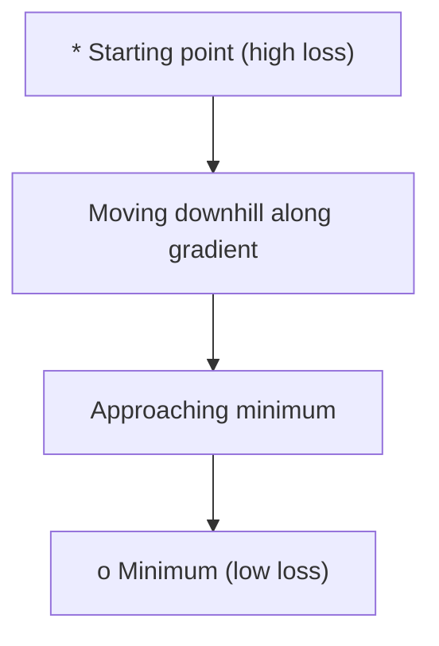
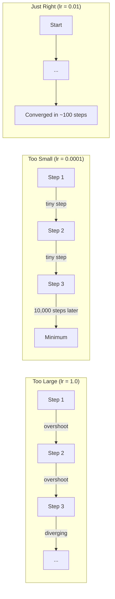
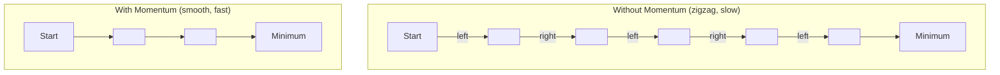
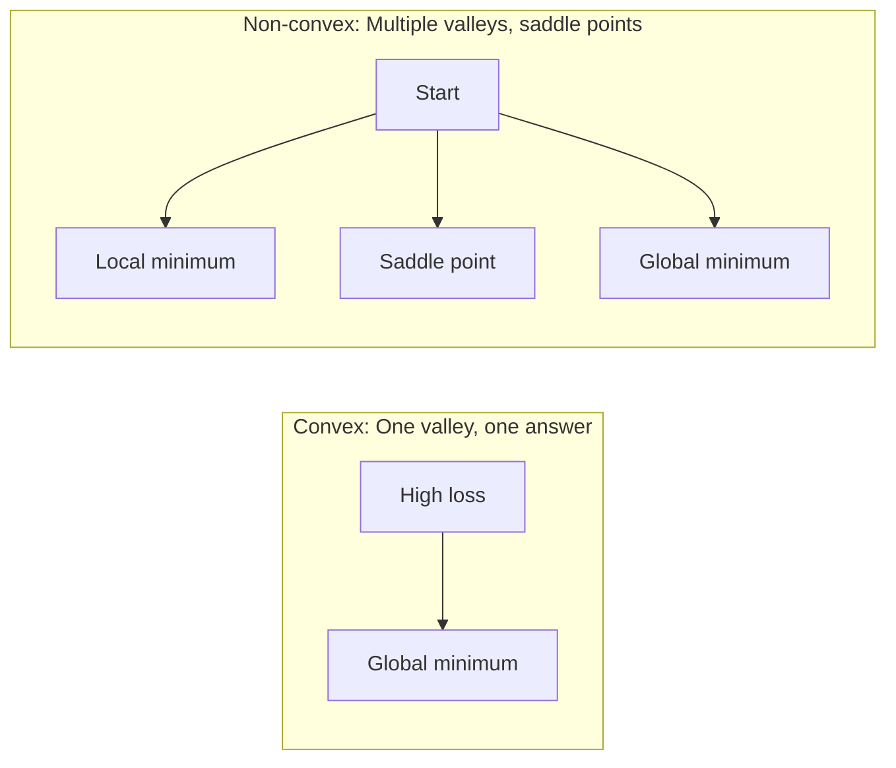
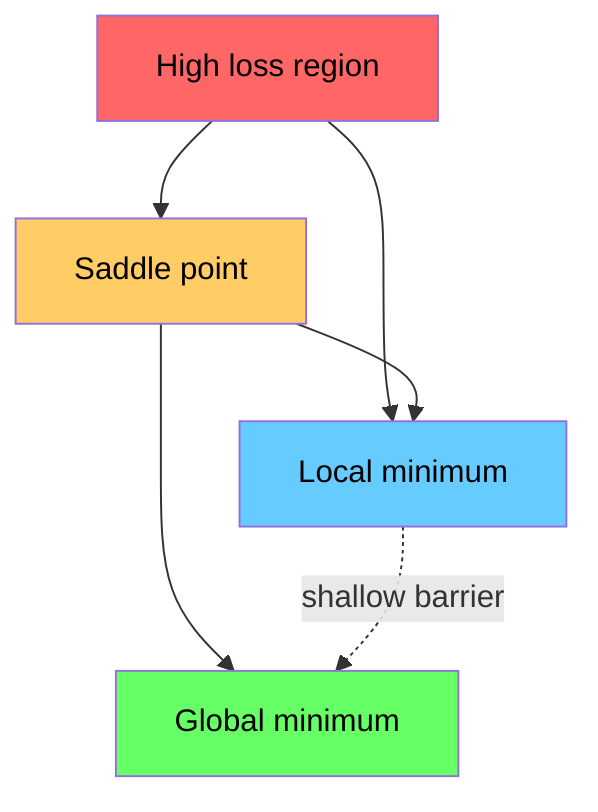

# 优化（Optimization）

> 训练神经网络，可以直观地理解为在损失函数构成的地形中寻找谷底。

**课程类型：** 动手构建（Build）  
**编程语言：** Python  
**先修课程：** Phase 1，第 04—05 课（导数、梯度）  
**预计用时：** 约 75 分钟

> **精译说明（2026-11-04）：** 本文完整对照本课官方英文 `docs/en.md` 翻译。全部 17 个代码与图示块的主体内容保持原文不变；代码围栏补充语言标识，网站专属 `figure` 指令改为兼容 GitHub 的文本展示。术语采用通行的机器学习译名。原文中存在适用条件不明确或过于绝对的表述，以“译注”补充条件，而不直接改变官方代码。本文件替代此前从上游 `translations` 分支导入的未经校对的机器译本。原项目的版权和 MIT 许可证见仓库根目录 `LICENSE`。

## 学习目标

- 从零实现标准梯度下降（vanilla gradient descent）、带动量的随机梯度下降（SGD with momentum）和 Adam；
- 在 Rosenbrock 函数上比较收敛情况，并解释 Adam 如何为不同参数自适应缩放更新步长；
- 区分凸与非凸损失地形，理解高维优化中的鞍点（saddle point）；
- 掌握学习率调度：阶梯衰减（step decay）、余弦退火（cosine annealing）和预热（warmup）。

## 问题（The Problem）

你已经有了损失函数，它衡量模型有多大误差；也已经会计算梯度，它指出损失在局部增加最快的方向。现在，需要设计一套策略，沿损失下降的方向调整模型参数。

最朴素的方法是：沿**负梯度**方向移动，把步长乘以某个称为**学习率（learning rate）**的系数，再重复这一过程。这就是梯度下降。它确实有效，但有明显限制：学习率太大，会跨过谷底，可能在两侧振荡甚至发散；学习率太小，成千上万次更新也可能进展很慢；遇到梯度为零的鞍点时，算法可能停住，尽管此时尚未找到最小值。

深度学习中各种优化器都在尝试回答同一个问题：**怎样更快、更可靠地找到足够低的损失？**

## 概念（The Concept）

### 优化是什么意思（What optimization means）

优化，就是寻找使一个函数最小（或最大）的输入值。在机器学习里，被优化的是**损失函数**，输入是模型的权重或其他可训练参数。因此，训练本身就是优化过程。

```text
minimize L(w) where:
  L = loss function
  w = model weights (could be millions of parameters)
```

数学形式为：

$$
\min_{\boldsymbol w}L(\boldsymbol w).
$$

### 标准梯度下降（Gradient descent, vanilla）

最基础的优化器：计算损失对每个权重的梯度，再沿梯度相反的方向调整权重。学习率决定每次更新的尺度。

```text
w = w - lr * gradient
```

其迭代公式为：

$$
\boldsymbol w_{t+1}=\boldsymbol w_t-\eta\nabla L(\boldsymbol w_t),\qquad \eta>0.
$$

这就是核心算法：计算梯度，然后反向迈一步。



**译注：** 原图写作“Moving downhill along gradient”，准确地说是沿**负梯度**下降。对于梯度非零的可微点，负梯度方向上的方向导数为

$$
\nabla L(\boldsymbol w)^\top[-\nabla L(\boldsymbol w)]
=-\|\nabla L(\boldsymbol w)\|_2^2<0.
$$

这是一阶局部结论；有限步长太大时，损失仍可能上升。

### 学习率：最关键的超参数（Learning rate）

学习率控制更新步长，对收敛速度和稳定性都有重要影响。



图中以三种情况示意：过大的学习率会越过谷底，可能振荡或发散；过小则移动缓慢；合适的学习率能更有效地降低损失。

不存在对所有任务都适用的最佳学习率公式，需要通过实验选择。原教材给出的常见起点为 Adam `0.001` 和带动量的 SGD `0.01`。

**译注：** 图中的数值、收敛所需步数只是示意，不是保证。学习率是否合适，还取决于曲率、损失尺度、batch size、模型结构和调度方式。

### SGD、全批量与小批量（SGD vs batch vs mini-batch）

**全批量梯度下降（batch gradient descent）**每次更新前对整个数据集计算梯度。它没有小批量抽样噪声，但每步的计算成本可能很高。

**随机梯度下降（SGD）**一次用一个随机样本计算梯度并立即更新。单步较快，但噪声很大。

**小批量梯度下降（mini-batch GD）**是两者的折中：从较小的 batch（例如 32、64、128 或 256 个样本）估计梯度，然后更新。真实深度学习训练广泛采用这种形式。

| 变体 | 每步使用的数据量 | 梯度估计质量 | 单步速度 | 噪声 |
|---|---|---|---|---|
| 全批量 GD | 整个数据集 | 完整训练集梯度 | 通常较慢 | 无抽样噪声 |
| SGD | 1 个样本 | 噪声较大 | 通常较快 | 高 |
| Mini-batch GD | 例如 32—256 个 | 通常较稳定的随机估计 | 折中 | 中等 |

SGD 和 mini-batch 的噪声并不一定是缺点：随机扰动**有时**能帮助优化器离开浅局部极小值或者鞍点附近的停滞区。

**译注：** 工程实现中的“SGD”也经常指 mini-batch SGD。噪声并非总有益，也不保证逃离任意鞍点。

### 动量：小球顺坡滚动（Momentum: the ball rolling downhill）

标准梯度下降只依赖当前梯度。对于狭窄的谷地，梯度方向可能在谷底两侧来回变化，导致轨迹呈锯齿形，整体进展缓慢。

**动量法（Momentum）**通过维护一个速度变量，累积过去梯度的信息：

```text
v = beta * v + gradient
w = w - lr * v
```

可以把它想象成沿山坡滚动的小球：它不会在每个小起伏处停下再重新开始，而会沿持续一致的方向积累惯性，同时减轻频繁换向产生的振荡。



`beta` 通常取 `0.9`，决定保留多少历史信息。较大的 `beta` 代表较强动量、轨迹可能更平滑，但梯度方向突然变化时也可能响应更慢。

**译注：** 这里采用 `v = beta * v + gradient` 的未归一化动量定义。部分框架采用带 `1-beta` 系数的指数移动平均，符号和参数更新尺度要对应分析。

### Adam：自适应学习率（Adam: adaptive learning rates）

不同权重可能需要不同的有效更新尺度。某个权重长期收到较大梯度时，更新可以被适当缩小；另一个权重的梯度尺度较小时，更新可能相对较大。

Adam 全称 **Adaptive Moment Estimation（自适应矩估计）**，它针对每个参数维护两种统计量：

1. **一阶矩估计（`m`）**：梯度的指数移动平均，与动量机制类似；
2. **二阶原始矩估计（`v`）**：梯度平方的指数移动平均，反映梯度的平方尺度。

```text
m = beta1 * m + (1 - beta1) * gradient
v = beta2 * v + (1 - beta2) * gradient^2

m_hat = m / (1 - beta1^t)    bias correction
v_hat = v / (1 - beta2^t)    bias correction

w = w - lr * m_hat / (sqrt(v_hat) + epsilon)
```

由于 `m`、`v` 都以零初始化，早期的统计量偏向零，因此需除以 `1-beta1^t` 和 `1-beta2^t` 进行**偏差修正（bias correction）**。

Adam 的关键在于用 `sqrt(v_hat)` 缩放一阶矩估计：当梯度平方的历史尺度较大时，分母变大，相应的归一化更新通常较小。这样，不同参数能够使用与自身梯度统计量相适应的步长。

原文给出的典型超参数是 `lr=0.001, beta1=0.9, beta2=0.999, epsilon=1e-8`。这些是常见起点，仍应按任务调整。

**译注：** `v` 是二阶**原始矩**的指数平均，并不是梯度的中心化方差。参数实际更新还依赖 `m_hat`、`epsilon` 及偏差修正，不能简单理解为“瞬时梯度越小，单步一定越大”。

### 学习率调度（Learning rate schedules）

固定学习率需要折中。训练前期常希望以较大步长加快进展，训练后期则希望以较小步长在低损失区域精细调整。

常见调度包括：

| 调度方式 | 数学规则 | 适用场景 |
|---|---|---|
| 阶梯衰减（Step decay） | 每 `N` 个 epoch 令 `lr = lr * factor` | 简单、人工可控 |
| 指数衰减（Exponential decay） | `lr = lr_0 * decay^t` | 平滑下降 |
| 余弦退火（Cosine annealing） | `lr = lr_min + 0.5 * (lr_max - lr_min) * (1 + cos(pi * t / T))` | Transformer 等现代模型训练 |
| 预热后衰减（Warmup + decay） | 先线性增大学习率，再逐渐下降 | 大模型训练中用于改善早期稳定性 |

**译注：** 上表的余弦公式表示 `t∈[0,T]` 上的半个余弦周期。若使用余弦重启（warm restarts），调度定义会不同。Warmup 是可选的独立阶段。

### 凸与非凸函数（Convex vs non-convex）

凸函数的一个重要性质是：**每个局部极小值都是全局极小值**。例如 `f(x)=x^2` 就是凸函数。

神经网络的损失函数通常是非凸的，可能存在多个局部极小值、鞍点和平坦区域。



原文指出，在高维网络的训练过程中，鞍点与平坦区域可能形成重要障碍。动量与 mini-batch 的随机扰动有时能帮助优化器摆脱这些区域。

**译注：** “梯度下降总能找到凸函数的最小值”缺少必要条件：是否收敛仍取决于光滑性、学习率、最小值是否存在等条件；凸函数的极小值也未必唯一。“高维神经网络的大多数局部极小值都接近全局最小值”同样不是对任意模型成立的普适定理。

### 损失地形可视化（Loss landscape visualization）

损失是所有参数的函数。对含有 100 万个权重的模型，其完整图像位于 100 万零 1 维空间，无法直接绘制。

一种常见的可视化方法是：在参数空间中选择两个方向，绘制沿这两个方向变化时的损失，得到二维参数平面上的三维曲面。它是高维函数的一个**二维切片**。



原文用“尖锐极小值（sharp minima）”和“平坦极小值（flat minima）”描述优化后参数附近的损失变化，并认为带动量的 SGD 在某些任务中可能得到比 Adam 更好的最终测试准确率。

**译注：** “尖锐极小值泛化差、平坦极小值泛化好”不能作为无条件定理。尖锐程度会受到参数重参数化和度量方式的影响；不同优化器的泛化优劣必须在一致的数据划分、模型结构与训练预算下实测。

> **图示兼容说明：** 下方 `gradient-descent` 是原课程网站的自定义图示标识，不是 GitHub Markdown 图片指令。保留原始标识方便对照；GitHub 页面不会直接生成该交互图。

```text
gradient-descent
```

## 从零构建（Build It）

### 第 1 步：定义测试函数（Define a test function）

**Rosenbrock 函数**是经典优化基准。它在 `(1,1)` 处达到全局最小值，低损失区域是一条狭窄弯曲的谷地：找到低损失区域相对容易，但沿着谷地稳定前进比较困难。

```text
f(x, y) = (1 - x)^2 + 100 * (y - x^2)^2
```

以下分别实现函数值与解析梯度：

```python
def rosenbrock(params):
    x, y = params
    return (1 - x) ** 2 + 100 * (y - x ** 2) ** 2

def rosenbrock_gradient(params):
    x, y = params
    df_dx = -2 * (1 - x) + 200 * (y - x ** 2) * (-2 * x)
    df_dy = 200 * (y - x ** 2)
    return [df_dx, df_dy]
```

其偏导数是：

$$
\frac{\partial f}{\partial x}=-2(1-x)-400x(y-x^2),\qquad
\frac{\partial f}{\partial y}=200(y-x^2).
$$

两个式子均可由链式法则直接得出，并可与中心有限差分进行数值对照。

### 第 2 步：标准梯度下降（Vanilla gradient descent）

通过一个简单的 Python 类封装学习率，并实现一次参数更新：

```python
class GradientDescent:
    def __init__(self, lr=0.001):
        self.lr = lr

    def step(self, params, grads):
        return [p - self.lr * g for p, g in zip(params, grads)]
```

每次调用 `step(params, grads)` 时，根据当前参数和梯度计算下一步参数。这个类只负责更新，不负责自动求导。

### 第 3 步：带动量的 SGD（SGD with momentum）

在标准 GD 基础上加入 `velocity` 状态，保留历史梯度的信息：

```python
class SGDMomentum:
    def __init__(self, lr=0.001, momentum=0.9):
        self.lr = lr
        self.momentum = momentum
        self.velocity = None

    def step(self, params, grads):
        if self.velocity is None:
            self.velocity = [0.0] * len(params)
        self.velocity = [
            self.momentum * v + g
            for v, g in zip(self.velocity, grads)
        ]
        return [p - self.lr * v for p, v in zip(params, self.velocity)]
```

`velocity` 在第一次调用时初始化为零向量，随后会随更新不断变化。因此，应在整个训练过程中复用同一个优化器对象，而不是每一步重新实例化。

**译注：** 虽然类名是 `SGDMomentum`，后续 Rosenbrock 实验使用的是确定性的完整解析梯度，并没有随机采样。因此该实验比较的是**更新规则**，并非随机抽样带来的 SGD 噪声。

### 第 4 步：Adam

Adam 维护一阶矩 `m`、二阶矩 `v` 和迭代步数 `t`；更新参数前，先对两个指数移动平均做偏差修正：

```python
class Adam:
    def __init__(self, lr=0.001, beta1=0.9, beta2=0.999, epsilon=1e-8):
        self.lr = lr
        self.beta1 = beta1
        self.beta2 = beta2
        self.epsilon = epsilon
        self.m = None
        self.v = None
        self.t = 0

    def step(self, params, grads):
        if self.m is None:
            self.m = [0.0] * len(params)
            self.v = [0.0] * len(params)

        self.t += 1

        self.m = [
            self.beta1 * m + (1 - self.beta1) * g
            for m, g in zip(self.m, grads)
        ]
        self.v = [
            self.beta2 * v + (1 - self.beta2) * g ** 2
            for v, g in zip(self.v, grads)
        ]

        m_hat = [m / (1 - self.beta1 ** self.t) for m in self.m]
        v_hat = [v / (1 - self.beta2 ** self.t) for v in self.v]

        return [
            p - self.lr * mh / (vh ** 0.5 + self.epsilon)
            for p, mh, vh in zip(params, m_hat, v_hat)
        ]
```

其中 `epsilon` 是数值稳定项，避免分母过小或为零。实际框架中还可能采用其他数值实现细节。

### 第 5 步：运行并比较（Run and compare）

以下程序使用同一个 Rosenbrock 函数与初始点，分别运行 GD、带动量的 SGD 和 Adam：

```python
def optimize(optimizer, func, grad_func, start, steps=5000):
    params = list(start)
    history = [params[:]]
    for _ in range(steps):
        grads = grad_func(params)
        params = optimizer.step(params, grads)
        history.append(params[:])
    return history

start = [-1.0, 1.0]

gd_history = optimize(GradientDescent(lr=0.0005), rosenbrock, rosenbrock_gradient, start)
sgd_history = optimize(SGDMomentum(lr=0.0001, momentum=0.9), rosenbrock, rosenbrock_gradient, start)
adam_history = optimize(Adam(lr=0.01), rosenbrock, rosenbrock_gradient, start)

for name, history in [("GD", gd_history), ("SGD+M", sgd_history), ("Adam", adam_history)]:
    final = history[-1]
    loss = rosenbrock(final)
    print(f"{name:6s} -> x={final[0]:.6f}, y={final[1]:.6f}, loss={loss:.8f}")
```

原文预期 Adam 在这个例子中收敛最快，带动量的优化器在狭窄谷地中运动更平滑，而普通 GD 进展较慢。

**译注：** “Adam 最快”只是**原文对当前示例的预期**，不是普适规律。这三个优化器设置了不同学习率。比较时应运行代码，检查最终损失、收敛曲线、数值发散，并区分迭代次数、梯度评估次数和实际墙钟时间。

## 在实际项目中使用（Use It）

真实项目一般采用 PyTorch 或 JAX 的优化器。它们可配合参数组、权重衰减（weight decay）、梯度裁剪及 GPU 加速。

例如 PyTorch 中可初始化 SGD、Adam、AdamW 及余弦学习率调度器：

```python
import torch

model = torch.nn.Linear(784, 10)

sgd = torch.optim.SGD(model.parameters(), lr=0.01, momentum=0.9)
adam = torch.optim.Adam(model.parameters(), lr=0.001)
adamw = torch.optim.AdamW(model.parameters(), lr=0.001, weight_decay=0.01)

scheduler = torch.optim.lr_scheduler.CosineAnnealingLR(adam, T_max=100)
```

原教材给出以下经验建议：

- 从 Adam（`lr=0.001`）开始，先验证训练管道能否正常工作，再调整超参数；
- 如果更重视最终测试准确率并能承担较多调参工作，可比较带动量的 SGD（`lr=0.01, momentum=0.9`）；
- 对 Transformer，通常可以考虑 AdamW（权重衰减与自适应梯度更新解耦）；
- 对较长的训练过程，学习率调度往往有帮助；
- 训练不稳定时先检查学习率是否过大，训练进展过慢时则考虑适当提高学习率。

**译注：** 上述均为经验起点，不能保证每项任务都有效。代码只创建了调度器，并没有实现训练循环或调用 `scheduler.step()`。

## 交付成果（Ship It）

本课的交付物是用于帮助选择优化器的提示词模板，参见 `outputs/prompt-optimizer-guide.md`。

这一课实现的优化器类还会在 Phase 3 的从零训练神经网络课程中再次出现。

## 官方练习（Exercises）

1. **学习率扫描（Learning rate sweep）**：在 Rosenbrock 函数上使用标准梯度下降，学习率依次设置为 `[0.0001, 0.0005, 0.001, 0.005, 0.01]`。每种配置运行 5000 步，绘制或打印最终损失，找出其中仍能收敛的最大学习率。

2. **动量比较（Momentum comparison）**：以 `[0.0, 0.5, 0.9, 0.99]` 作为动量系数运行带动量的优化器，记录每步损失。哪种动量收敛最快？哪种更容易越过谷底（overshoot）？

3. **鞍点逃逸（Saddle point escape）**：定义 `f(x,y)=x^2-y^2`，原点为鞍点。从 `(0.01,0.01)` 出发，比较普通 GD、带动量的 SGD 与 Adam 的表现，观察哪种方法更快离开鞍点附近。

4. **实现学习率衰减（Implement learning rate decay）**：为 `GradientDescent` 类增加指数衰减规则：`lr = lr_0 * 0.999^step`。在 Rosenbrock 函数上对比固定学习率和衰减学习率的效果。

**译注：** 第 3 题的起点不是梯度等于零的原点，所以完全确定性的 GD 也可能逃离鞍点邻域。应明确“逃离”的判据，才能比较不同优化器。

## 核心术语（Key Terms）

| 术语 | 通俗说法 | 技术含义 |
|---|---|---|
| 梯度下降（Gradient descent） | “沿坡面往下走” | 以学习率缩放梯度，沿其反方向更新参数的基础优化方法。 |
| 学习率（Learning rate） | “步长” | 控制参数每步变化的超参数；过大可能发散，过小会浪费计算。 |
| 动量（Momentum） | “保持惯性” | 累积历史梯度，减轻振荡并可能加速沿一致方向的进展。 |
| SGD | “随机抽样” | 使用单个样本或随机小批量估计梯度的优化方式。 |
| Mini-batch | “一小批样本” | 通过部分数据估计梯度，平衡计算成本与估计稳定性。 |
| Adam | “常用优化器” | 对梯度与梯度平方的移动平均进行偏差修正，提供逐参数自适应缩放。 |
| 偏差修正（Bias correction） | “纠正冷启动偏差” | 消除移动平均零初始化造成的早期向零偏差，涉及 `1-beta^t` 等因子。 |
| 学习率调度（Learning rate schedule） | “随训练调整步长” | 根据训练进度变化学习率的规则，常见预热、衰减和余弦退火。 |
| 凸函数（Convex function） | “局部最优就是全局最优” | 所有局部极小值均为全局极小值，但任意学习率的 GD 未必能收敛。 |
| 鞍点（Saddle point） | “既不是谷底也不是山顶” | 在不同方向上具有不同局部曲率性质的驻点，可导致优化停滞。 |
| 损失地形（Loss landscape） | “损失曲面” | 随参数变化的高维损失函数，通常通过低维切片可视化。 |
| 收敛（Convergence） | “到达稳定状态” | 迭代在指定意义下趋于稳定，可能用损失、梯度或参数变化定义停止条件。 |

## 延伸阅读（Further Reading）

- [Sebastian Ruder：梯度下降优化算法综述](https://ruder.io/optimizing-gradient-descent/)——系统介绍常见优化器。
- [Distill：Why Momentum Really Works](https://distill.pub/2017/momentum/)——用交互可视化解释动量机制。
- [Kingma 与 Ba（2014）：Adam: A Method for Stochastic Optimization](https://arxiv.org/abs/1412.6980)——Adam 原始论文。
- [Li 等（2018）：Visualizing the Loss Landscape of Neural Nets](https://arxiv.org/abs/1712.09913)——神经网络损失地形的可视化研究。
