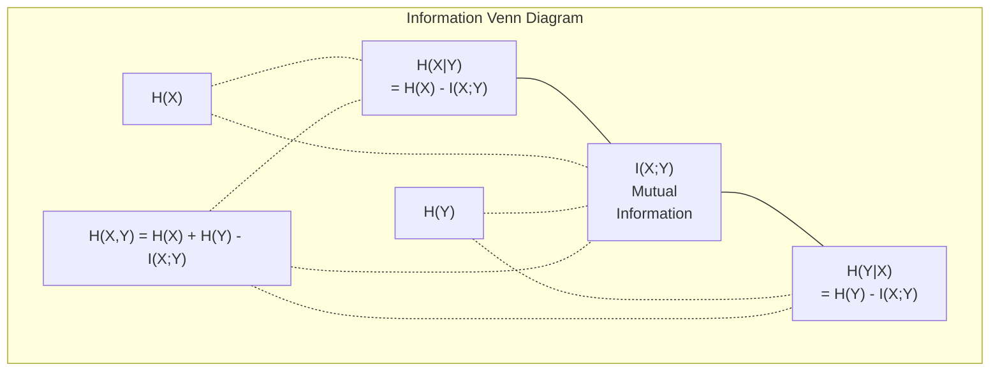

# 信息论（Information Theory）

> 信息论度量事件的意外程度与概率分布的不确定性，分类损失、分布匹配、特征选择和语言模型评估都用得到。

**类型：** Learn  
**语言：** Python  
**前置知识：** 01/06 概率与分布  
**预计时长：** 约 60 分钟（实际按理解进度延长）

**翻译与校对说明：** 本文独立依据官方英文 docs/en.md 对照整理。上游 translations 分支有中文版本，但多个术语误译，故没有直接照搬。所有六段官方 Python 教学代码和原 Mermaid 图的正文逐字保留。对原文中需要限定适用条件的说法，添加了技术校注。

## 学习目标（Learning Objectives）

- 从零计算**熵、交叉熵、KL 散度**并推导三者关系。
- 理解最小化交叉熵为何等价于最大化数据的对数似然。
- 计算特征与目标之间的互信息，并用于评估特征的预测信息量。
- 用困惑度解释语言模型在测试 token 上的预测不确定性。

## 实际问题（The Problem）

分类训练中经常调用 CrossEntropyLoss；语言模型论文报告 Perplexity；VAE、蒸馏和 RLHF 等方法常出现 KL 散度。它们都依赖同一套数学语言：如何使用概率分布描述事件的不确定性、预测质量和信息差异。

现代信息论由 Claude Shannon 在 1948 年为通信问题奠定基础。预测模型可以被视为一种概率编码系统：它对实际观察赋予不同概率，概率越低的真实结果，对数损失越大。本节会把定义、计算、机器学习应用统一起来。

## 核心概念（The Concept）

### 1. 信息量 / 惊讶度（Information Content / Surprise）

一个低概率事件真的发生时，通常比高概率事件提供更多新信息。对于概率为 $p(x)$ 的事件 $x$，自信息量定义为：

$$
\boxed{I_b(x)=-\log_b p(x)},\qquad b>1.
$$

底数 $b=2$ 时以 **bit（比特）**计；$b=e$ 时以 **nat（奈特）**计。确定事件 $p=1$ 的信息量为 0；$p\to0^+$ 时信息量趋于正无穷。

| 事件 | 发生概率 | 信息量（bits） |
|---|---:|---:|
| 公平硬币正面 | 0.5 | 1 |
| 六面骰子投出 6 | $1/6$ | 约 2.585 |
| 概率为千分之一的事件 | 0.001 | 约 9.966 |
| 确定事件 | 1 | 0 |

### 2. 熵（Entropy）：平均惊讶度

设离散随机变量 $X$ 服从分布 $P$，概率质量函数为 $p(x)$。熵等于自信息量的期望：

$$
\begin{aligned}
H_b(P)
&=\mathbb E_{X\sim P}[I_b(X)]\\
&=\boxed{-\sum_x p(x)\log_b p(x)}.
\end{aligned}
$$

按连续极限约定 $0\log0=0$。

公平硬币的熵：

$$
H_2(0.5,0.5)=-0.5\log_2(0.5)-0.5\log_2(0.5)=1\ \mathrm{bit}.
$$

如果正面概率为 0.99：

$$
H_2(0.99,0.01)=-0.99\log_2(0.99)-0.01\log_2(0.01)
\approx0.0808\ \mathrm{bit}.
$$

对于 $n$ 种离散结果，均匀分布达到最大熵 $\log_b n$；分布越偏向少数结果，平均不确定性越低。

**编码意义：** 熵是平均无损编码长度的理论极限之一，在相应编码模型与渐近条件下可以接近。并非声称任何有限文件的大小都不可能低于熵。

### 3. 交叉熵（Cross-Entropy）：分类中的损失

设真实事件分布为 $P$，模型预测为 $Q$。用 $Q$ 给来自 $P$ 的结果分配概率，其平均对数代价是：

$$
\boxed{H_b(P,Q)=-\sum_xp(x)\log_b q(x)}.
$$

当 $Q=P$ 时，交叉熵等于 $H(P)$。如果真实可能的事件被模型赋予零概率，即某个 $p(x)>0$ 而 $q(x)=0$，交叉熵为无穷大。

分类任务的监督标签通常是 **one-hot**：真实类 $y$ 对应的 $p_y=1$，其他类概率为 0。因此：

$$
H(P,Q)=-\sum_kp_k\log q_k=\boxed{-\log q_y}.
$$

模型赋予真实类别的概率越高，交叉熵损失越低；这一点与你已学过的 Softmax + CrossEntropyLoss 完全吻合。

### 4. KL 散度（KL Divergence）

相对于使用正确分布 $P$，使用 $Q$ 会产生多少额外的平均对数代价？定义为：

$$
\begin{aligned}
D_{\mathrm{KL}}(P\Vert Q)
&=\sum_xp(x)\log\frac{p(x)}{q(x)}\\
&=\boxed{H(P,Q)-H(P)}.
\end{aligned}
$$

第二个等号可直接用 $\log(p/q)=\log p-\log q$ 推出。

KL 散度非负。当真实目标分布 $P$ 固定、不依赖模型参数 $\theta$ 时，$H(P)$ 是常量，因此：

$$
\underset{\theta}{\arg\min}\ H(P,Q_\theta)
=\underset{\theta}{\arg\min}\ D_{\mathrm{KL}}(P\Vert Q_\theta).
$$

这是“最小化交叉熵等价于减小分布差异”的严格条件。KL 散度**不对称**，一般 $D_{\mathrm{KL}}(P\Vert Q)\ne D_{\mathrm{KL}}(Q\Vert P)$，不能视作标准距离度量。

### 5. 互信息（Mutual Information）

互信息衡量观察 $Y$ 后，对 $X$ 的平均不确定性能降低多少：

$$
\boxed{
I(X;Y)=H(X)-H(X\mid Y)
=H(Y)-H(Y\mid X)
}.
$$

等价地：

$$
I(X;Y)=H(X)+H(Y)-H(X,Y).
$$

如果 $X$ 与 $Y$ 独立，互信息为 0；如果一个变量能完全决定另一个变量，条件熵可降至 0。机器学习中可计算特征 $X_i$ 与标签 $Y$ 的互信息，对特征做初步排序，但要检查样本估计偏差、特征冗余和泛化情况。

### 6. 条件熵（Conditional Entropy）

观察 $X$ 后，$Y$ 的剩余平均不确定性是：

$$
\boxed{H(Y\mid X)=H(X,Y)-H(X)}.
$$

- 若 $X$ 完全决定 $Y$：$H(Y\mid X)=0$，如摄氏温度决定华氏温度。
- 若 $X,Y$ 独立：$H(Y\mid X)=H(Y)$，因为 $X$ 没提供关于 $Y$ 的信息。

对于离散变量：

$$
0\le H(Y\mid X)\le H(Y).
$$

**应用：** 决策树倾向于选择能显著降低标签条件熵的划分特征，相当于选择更大的信息增益。

### 7. 联合熵（Joint Entropy）

同时观察变量 $X,Y$ 时，联合分布的熵定义为：

$$
\boxed{H(X,Y)=-\sum_x\sum_y p(x,y)\log p(x,y)}.
$$

重要性质：

$$
H(X,Y)\le H(X)+H(Y),
$$

并且当 $X,Y$ 独立时取等号。与互信息联立：

$$
\boxed{H(X,Y)=H(X)+H(Y)-I(X;Y)}.
$$

官方信息关系图：



联合熵、条件熵和互信息之间还有两组链式关系：

$$
\begin{aligned}
H(X,Y)&=H(X)+H(Y\mid X)\\
      &=H(Y)+H(X\mid Y),\\
I(X;Y)&=H(X)-H(X\mid Y)\\
      &=H(Y)-H(Y\mid X).
\end{aligned}
$$

### 8. 互信息深入：与 KL 散度、相关系数的区别

使用联合分布 $p(x,y)$ 与边缘分布 $p(x),p(y)$：

$$
\boxed{I(X;Y)=\sum_x\sum_y p(x,y)\log\frac{p(x,y)}{p(x)p(y)}}.
$$

也就是说：

$$
I(X;Y)=D_{\mathrm{KL}}(P_{XY}\Vert P_XP_Y).
$$

因此互信息的主要性质是：

- $I(X;Y)\ge0$。
- $I(X;Y)=0$ 当且仅当 $X,Y$ 独立。
- $I(X;Y)=I(Y;X)$，它是对称的。
- $I(X;X)=H(X)$（离散随机变量）。

**用于特征选择的步骤：** 对每个候选特征 $X_i$ 估计 $I(X_i;Y)$，按分值排序，再结合特征冗余、任务指标和验证集选择前 $k$ 个。

| 方法 | 可反映的关系 | 典型特点 | 类别特征 |
|---|---|---|---|
| Pearson 相关 | 线性关系 | 计算简单；依赖合理的数值编码 | 编码方式影响含义 |
| Spearman 相关 | 单调关系 | 使用秩，对单调非线性敏感 | 需要有意义的顺序 |
| 互信息 | 一般统计依赖关系 | 对离散量可以计数估计，连续量需密度或邻域等方法 | 可以 |

**技术校注：** 理论互信息可以反映广义依赖，但有限样本估计并不一定准确；不能认为单一互信息估计器在任何特征类型、样本量下都具有原文表格中统一的 $O(n\log n)$ 复杂度。

### 9. 标签平滑（Label Smoothing）与交叉熵

普通分类的硬标签可以写成 $[0,0,1,0]$。标签平滑把 one-hot 目标 $y$ 与均匀分布 $u$ 混合：

$$
\widetilde y=(1-\epsilon)y+\epsilon u,\qquad u_k=\frac1C.
$$

在 $C=4,\epsilon=0.1$ 时：

$$
y=[0,0,1,0],\quad
\widetilde y=[0.025,0.025,0.925,0.025].
$$

硬标签的熵为 0，平滑后目标分布具有正熵。交叉熵按线性关系分解：

$$
H(\widetilde y,q)=(1-\epsilon)H(y,q)+\epsilon H(u,q).
$$

这样可以减少将预测概率无限推向 one-hot 的激励，作为控制过度自信的正则化手段。某些任务中可能改善校准或泛化，但效果必须经实验确认。

### 10. 为什么交叉熵是分类任务的主要损失？

有三种互相联系的角度：

**信息论：** 模型 $Q$ 与真实目标 $P$ 不匹配时，交叉熵会额外增加，增加量即为 KL 散度。

**最大似然：** 若训练观测为 $(x_i,y_i)_{i=1}^N$，假设样本在给定输入及模型参数时条件独立，则：

$$
\begin{aligned}
\mathcal L(\theta)
&=\prod_{i=1}^{N}q_\theta(y_i\mid x_i),\\
\log\mathcal L(\theta)
&=\sum_{i=1}^{N}\log q_\theta(y_i\mid x_i),\\
\mathrm{NLL}(\theta)
&=-\sum_{i=1}^{N}\log q_\theta(y_i\mid x_i).
\end{aligned}
$$

将 NLL 除以 $N$ 就得到 one-hot 分类标签的**平均交叉熵**。因此最小化平均交叉熵等价于最大化训练数据的似然。

**梯度：** 模型输出 logits $z\in\mathbb R^C$，Softmax 概率 $q_k=e^{z_k}/\sum_j e^{z_j}$，目标向量为 $y$（$\sum_k y_k=1$）时：

$$
\boxed{\frac{\partial H(y,q)}{\partial z_k}=q_k-y_k}.
$$

这个简洁结果也是 Softmax + CrossEntropy 在反向传播中常一起使用的原因。

### 11. Bits 与 Nats

单位只取决于对数底数：

- 底数 2：**bits**，传统信息论常用。
- 底数 $e$：**nats**，深度学习框架常用。
- 底数 10：**hartleys**，较少用。

换算关系：

$$
1\ \mathrm{nat}=\frac{1}{\ln2}\ \mathrm{bits}\approx1.4427\ \mathrm{bits}.
$$

PyTorch 的 CrossEntropyLoss 通常以自然对数计算，所以其数值单位是 nats。

### 12. 困惑度（Perplexity）

对于语言模型在测试样本真实 token 上的平均交叉熵，困惑度定义为：

$$
\boxed{\mathrm{PPL}=e^{H_{\mathrm{nat}}}=2^{H_{\mathrm{bit}}}}.
$$

如果平均损失等于 $\ln50$ nats，则困惑度为 $50$。从等效意义上，它相当于在平均对数损失上，模型需要在 50 个等概率候选项之间猜测。

**注意：** 它不意味着模型每步真的均匀地从 50 个 token 中取一个。越低的 PPL 通常对应越高的测试集 token 预测概率；但比较不同模型时必须考虑数据集、分词器、文本长度以及评估口径。官方原文提及特定模型的困惑度数值，缺少完整基准条件，不将其作为通用结论。

原文的自定义页面图指令（entropy-kl）不一定在 GitHub 中渲染，因此本版以可复核的数学关系和后续真实实验解释。

## 从零实现（Build It）

以下六段代码中，本章 Build It 的五段 Python 代码与 Use It 的一段 NumPy 代码均直接保留官方正文，课堂会逐段解释和验证。

### Step 1：信息量与熵

```python
import math

def information_content(p, base=2):
    if p <= 0 or p > 1:
        return float('inf') if p <= 0 else 0.0
    return -math.log(p) / math.log(base)

def entropy(probs, base=2):
    return sum(
        p * information_content(p, base)
        for p in probs if p > 0
    )

fair_coin = [0.5, 0.5]
biased_coin = [0.99, 0.01]
fair_die = [1/6] * 6

print(f"Fair coin entropy:   {entropy(fair_coin):.4f} bits")
print(f"Biased coin entropy: {entropy(biased_coin):.4f} bits")
print(f"Fair die entropy:    {entropy(fair_die):.4f} bits")
```

比较公平硬币、偏置硬币和公平六面骰子的平均不确定性。

### Step 2：交叉熵与 KL 散度

```python
def cross_entropy(p, q, base=2):
    total = 0.0
    for pi, qi in zip(p, q):
        if pi > 0:
            if qi <= 0:
                return float('inf')
            total += pi * (-math.log(qi) / math.log(base))
    return total

def kl_divergence(p, q, base=2):
    return cross_entropy(p, q, base) - entropy(p, base)

true_dist = [0.7, 0.2, 0.1]
good_model = [0.6, 0.25, 0.15]
bad_model = [0.1, 0.1, 0.8]

print(f"Entropy of true dist:     {entropy(true_dist):.4f} bits")
print(f"CE (good model):          {cross_entropy(true_dist, good_model):.4f} bits")
print(f"CE (bad model):           {cross_entropy(true_dist, bad_model):.4f} bits")
print(f"KL divergence (good):     {kl_divergence(true_dist, good_model):.4f} bits")
print(f"KL divergence (bad):      {kl_divergence(true_dist, bad_model):.4f} bits")
```

对真实分布和两个模型分布计算 $H(P)$、$H(P,Q)$、$D_{\mathrm{KL}}(P\Vert Q)$，并检验 $\mathrm{CE}=\mathrm{Entropy}+\mathrm{KL}$。输入应是合法、同长度、归一化的分布，生产代码应额外校验。

### Step 3：分类交叉熵

```python
def softmax(logits):
    max_logit = max(logits)
    exps = [math.exp(z - max_logit) for z in logits]
    total = sum(exps)
    return [e / total for e in exps]

def cross_entropy_loss(true_class, logits):
    probs = softmax(logits)
    return -math.log(probs[true_class])

logits = [2.0, 1.0, 0.1]
true_class = 0

probs = softmax(logits)
loss = cross_entropy_loss(true_class, logits)

print(f"Logits:      {logits}")
print(f"Softmax:     {[f'{p:.4f}' for p in probs]}")
print(f"True class:  {true_class}")
print(f"Loss:        {loss:.4f} nats")
print(f"Perplexity:  {math.exp(loss):.2f}")
```

先以数值稳定的 Softmax 归一化 logits，再通过真实标签索引求 $-\log q_y$，并用指数解释样本困惑度。

### Step 4：交叉熵 = 负对数似然

```python
import random

random.seed(42)

n_samples = 1000
n_classes = 3
true_labels = [random.randint(0, n_classes - 1) for _ in range(n_samples)]
model_logits = [[random.gauss(0, 1) for _ in range(n_classes)] for _ in range(n_samples)]

ce_loss = sum(
    cross_entropy_loss(label, logits)
    for label, logits in zip(true_labels, model_logits)
) / n_samples

nll = -sum(
    math.log(softmax(logits)[label])
    for label, logits in zip(true_labels, model_logits)
) / n_samples

print(f"Cross-entropy loss:      {ce_loss:.6f}")
print(f"Negative log-likelihood: {nll:.6f}")
print(f"Difference:              {abs(ce_loss - nll):.2e}")
```

用固定随机种子生成 1000 个三分类样本，对比平均交叉熵与平均负对数似然数值。

### Step 5：互信息计算

```python
def mutual_information(joint_probs, base=2):
    rows = len(joint_probs)
    cols = len(joint_probs[0])

    margin_x = [sum(joint_probs[i][j] for j in range(cols)) for i in range(rows)]
    margin_y = [sum(joint_probs[i][j] for i in range(rows)) for j in range(cols)]

    mi = 0.0
    for i in range(rows):
        for j in range(cols):
            pxy = joint_probs[i][j]
            if pxy > 0:
                mi += pxy * math.log(pxy / (margin_x[i] * margin_y[j])) / math.log(base)
    return mi

independent = [[0.25, 0.25], [0.25, 0.25]]
dependent = [[0.45, 0.05], [0.05, 0.45]]

print(f"MI (independent): {mutual_information(independent):.4f} bits")
print(f"MI (dependent):   {mutual_information(dependent):.4f} bits")
```

从 $2\times2$ 联合概率矩阵计算边缘分布，区分独立变量与相关变量的互信息。

## 生产库实现（Use It）

官方 NumPy 示例：

```python
import numpy as np

def np_entropy(p):
    p = np.asarray(p, dtype=float)
    mask = p > 0
    result = np.zeros_like(p)
    result[mask] = p[mask] * np.log(p[mask])
    return -result.sum()

def np_cross_entropy(p, q):
    p, q = np.asarray(p, dtype=float), np.asarray(q, dtype=float)
    mask = p > 0
    return -(p[mask] * np.log(q[mask])).sum()

def np_kl_divergence(p, q):
    return np_cross_entropy(p, q) - np_entropy(p)

true = np.array([0.7, 0.2, 0.1])
pred = np.array([0.6, 0.25, 0.15])
print(f"Entropy:    {np_entropy(true):.4f} nats")
print(f"Cross-ent:  {np_cross_entropy(true, pred):.4f} nats")
print(f"KL div:     {np_kl_divergence(true, pred):.4f} nats")
```

这几个函数使用掩码跳过 $p_i=0$ 的项；还需考虑 $q_i=0$ 时的边界值与概率归一化。PyTorch 的 CrossEntropyLoss 接受 logits，内部采用更稳定的 log-softmax 组合实现。数学目标相同，但批处理、权重和标签平滑等功能更多。

## 官方练习（Exercises）

1. 假设英文字母表中 26 个字母等概率出现，计算熵。再依据**真实字母频率**估计熵；比较结果大小并解释原因。真实频率需要注明数据来源及语料口径。
2. 对真实类别索引为 **1** 的样本，模型输出 logits 为 $[5.0,2.0,0.5]$。手算交叉熵损失，再用自己的 cross_entropy_loss 函数验证。何种 logits 才能使该损失为 0？区分有限 logits 和极限情况。
3. 举例证明 KL 散度不对称：任选两种分布 $P,Q$，计算 $D_{\mathrm{KL}}(P\Vert Q)$ 与 $D_{\mathrm{KL}}(Q\Vert P)$，解释两者为何不同。
4. 编写函数：输入一组（真实 token 索引、模型预测 logits）配对，计算整段序列的困惑度。

## 核心术语（Key Terms）

| 术语 | 实际意义 |
|---|---|
| 自信息量 / 惊讶度 | 单个事件的信息量 $-\log p$ |
| 熵 | 一个概率分布的平均惊讶度 / 平均不确定性 |
| 交叉熵 | 用模型分布解释真实数据的平均对数损失 |
| KL 散度 | 两个分布之间的相对信息代价，非对称 |
| 互信息 | 观察一个变量后另一个变量的不确定性减少量 |
| Softmax | 将实数 logits 映射成合法类别概率 |
| 困惑度 | 平均交叉熵的指数，常用于语言模型评估 |
| bit | 底数 2 的信息量单位 |
| nat | 自然对数的信息量单位 |
| 负对数似然（NLL） | 模型赋予真实观测概率的负对数 |

## 延伸阅读（Further Reading）

- Claude Shannon（1948）：[A Mathematical Theory of Communication](https://people.math.harvard.edu/~ctm/home/text/others/shannon/entropy/entropy.pdf)
- Chris Olah：[Visual Information Theory](https://colah.github.io/posts/2015-09-Visual-Information/)
- PyTorch：[CrossEntropyLoss 官方文档](https://pytorch.org/docs/stable/generated/torch.nn.CrossEntropyLoss.html)
